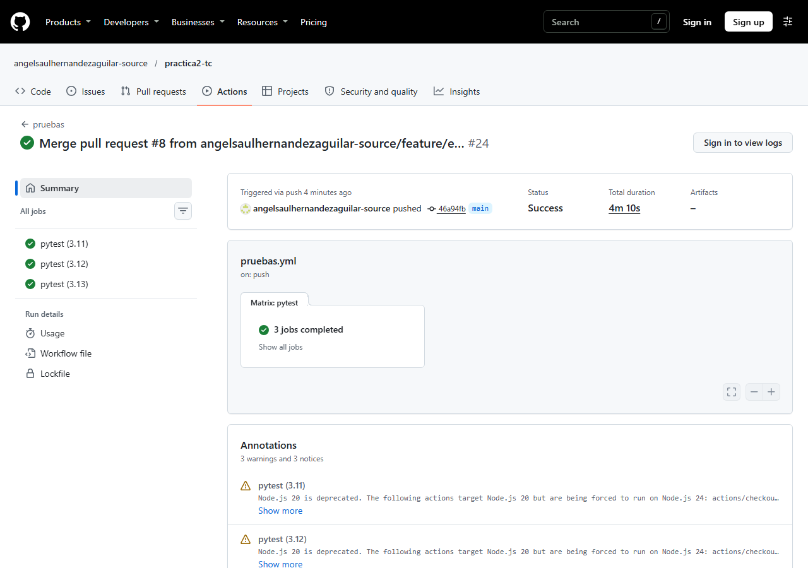
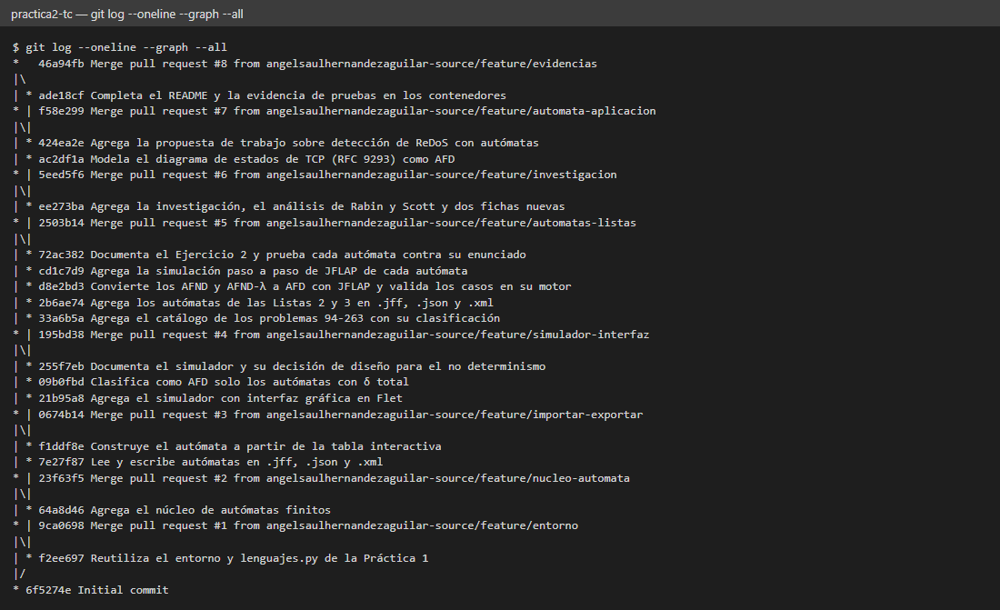
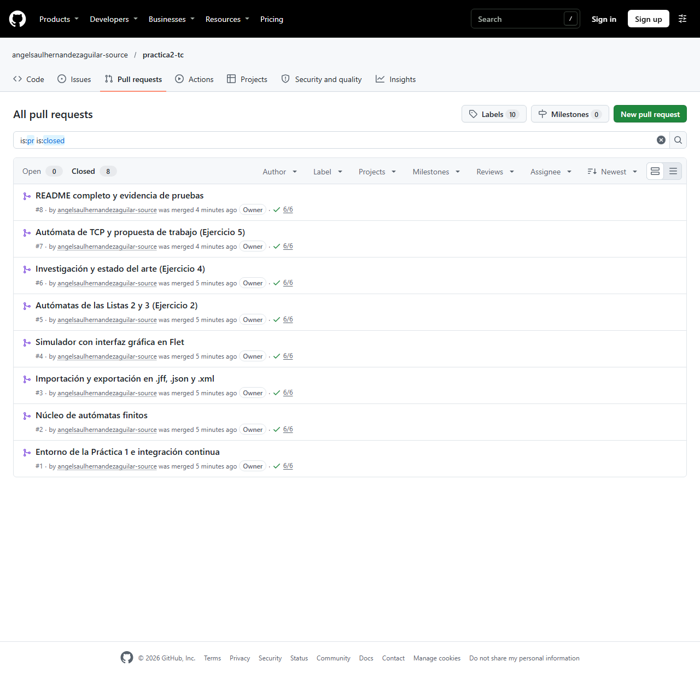

# Ejercicio 1. Entorno de trabajo y flujo de ramas

[← Volver al índice](../README.md)

## 1.1 Qué se reutilizó de la Práctica 1

El repositorio de la Práctica 1 es
[angelsaulhernandezaguilar-source/Teoria-computcion-4CM4](https://github.com/angelsaulhernandezaguilar-source/Teoria-computcion-4CM4).
De él se copiaron, sin volver a escribirlos:

| Archivo | Cambio respecto de la Práctica 1 |
|---|---|
| `entorno/Dockerfile` | Ninguno: la misma imagen `python:X.Y-slim` con el entorno virtual en `/opt/venv`. |
| `entorno/compose.yml` | Solo el nombre de los contenedores: `tc_p2_py311`, `tc_p2_py312`, `tc_p2_py313`, para que no choquen con los de la Práctica 1 si ambos existen en el mismo equipo. |
| `requirements.txt` | Ninguno: Flet 0.86.5 y pytest 8.3.4 con todas sus dependencias fijadas. El núcleo nuevo (`automata.py`, `formatos.py`) solo usa la biblioteca estándar (`xml.etree`, `json`), así que no hizo falta agregar paquetes. |
| `pytest.ini` | Se conserva `pythonpath = src herramientas` y `testpaths = tests`. |
| `src/lenguajes.py` y `tests/test_lenguajes.py` | Ninguno. La interfaz de esta práctica los importa para la pestaña de operaciones sobre lenguajes. |

## 1.2 Los tres contenedores

`compose.yml` define tres servicios construidos con el mismo `Dockerfile`, que recibe la versión como
argumento de construcción:

| Servicio | Imagen base | Uso |
|---|---|---|
| `py311` | `python:3.11-slim` | Ejecuta `pytest -q` |
| `py312` | `python:3.12-slim` | Levanta el simulador en `http://localhost:8550` |
| `py313` | `python:3.13-slim` | Ejecuta `pytest -q` |

Comandos (desde la carpeta `entorno/`):

```bash
docker compose build
docker compose run --rm py311 pytest -q
docker compose run --rm py312 pytest -q
docker compose run --rm py313 pytest -q
docker compose up py312      # interfaz en http://localhost:8550
```

El resultado de las pruebas en los tres contenedores está en
[`evidencias/ci/pytest-contenedores.txt`](../evidencias/ci/pytest-contenedores.txt).

## 1.3 Flujo de trabajo: una rama por funcionalidad

Ninguna confirmación se hizo directamente sobre `main` salvo la confirmación inicial que crea el
repositorio. Cada funcionalidad se desarrolló en su rama, se publicó con `git push -u origin <rama>`,
se abrió un *Pull Request* con su descripción y se fusionó desde GitHub con una confirmación de
fusión (*merge commit*), para que las fusiones queden visibles en el grafo.

| Rama | Contenido |
|---|---|
| `feature/entorno` | Entorno, `lenguajes.py` de la Práctica 1 e integración continua |
| `feature/nucleo-automata` | `src/automata.py`: quíntupla, λ-clausura, simulación, subconjuntos y Hopcroft |
| `feature/importar-exportar` | `src/formatos.py`: lectura y escritura de `.jff`, `.json` y `.xml` |
| `feature/simulador-interfaz` | `src/app.py`: definición manual, simulación paso a paso y operaciones de la Práctica 1 |
| `feature/automatas-listas` | Los autómatas de las Listas 2 y 3, sus conversiones y la evidencia de JFLAP |
| `feature/investigacion` | Ejercicio 4: investigación, artículo de Rabin y Scott y dos artículos nuevos |
| `feature/automata-aplicacion` | Ejercicio 5: el autómata de TCP y la propuesta de trabajo |
| `feature/evidencias` | README completo y resultado de pytest en los tres contenedores |
| `feature/capturas-evidencia` | Capturas del grafo de Git, de los *Pull Requests* y de GitHub Actions |

El ciclo de cada rama es el del Anexo 1 del enunciado:

```bash
git switch -c feature/importar-exportar
# ... trabajo y confirmaciones ...
git push -u origin feature/importar-exportar
gh pr create --base main --title "..." --body "..."
gh pr merge --merge
git switch main && git pull
git branch -d feature/importar-exportar
```

Los *Pull Requests* fusionados son los
[#1 a #9 del repositorio](https://github.com/angelsaulhernandezaguilar-source/practica2-tc/pulls?q=is%3Apr+is%3Aclosed);
cada uno describe el cambio que introduce. El último, el de las capturas, no puede aparecer en su propia
captura.

## 1.4 Integración continua

El archivo [`.github/workflows/pruebas.yml`](../.github/workflows/pruebas.yml) es el del Anexo 2: en
cada `push` y en cada *Pull Request* GitHub Actions crea tres ejecuciones independientes (la clave
`matrix` con `3.11`, `3.12` y `3.13`), instala `requirements.txt` y ejecuta `pytest -q`. Con
`fail-fast: false`, el fallo de una versión no cancela las otras dos. Es el equivalente remoto de
los tres contenedores locales. Las 24 ejecuciones generadas por las ramas, los *Pull Requests* y las fusiones
aprobaron con las tres versiones.







## 1.5 Evidencia

| Evidencia | Archivo |
|---|---|
| Dirección del repositorio | https://github.com/angelsaulhernandezaguilar-source/practica2-tc |
| `git log --oneline --graph --all` con las fusiones | [`evidencias/git/log-graph.png`](../evidencias/git/log-graph.png) ([texto](../evidencias/git/log-graph.txt)) |
| Lista de *Pull Requests* cerrados | [`evidencias/git/pull-requests.png`](../evidencias/git/pull-requests.png) |
| Ejecución de GitHub Actions con las tres versiones aprobadas | [`evidencias/ci/actions.png`](../evidencias/ci/actions.png) (ejecución #24 sobre `main`) y [`actions-lista.png`](../evidencias/ci/actions-lista.png) (todas las ejecuciones) |
| Pruebas en los tres contenedores | [`evidencias/ci/pytest-contenedores.txt`](../evidencias/ci/pytest-contenedores.txt) |
