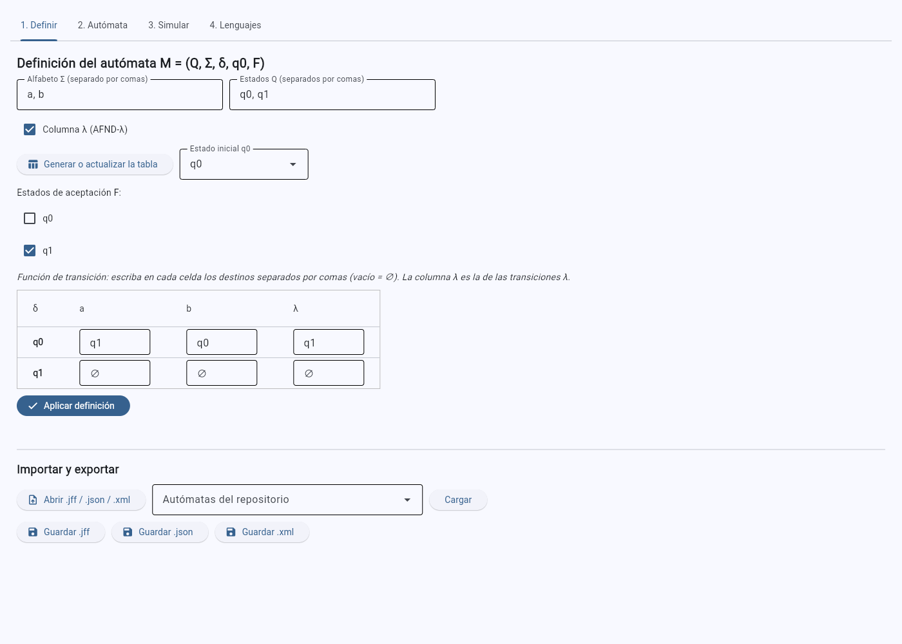
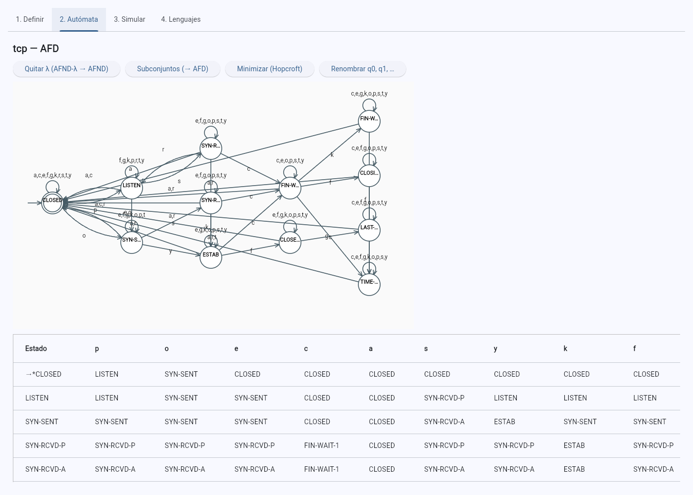
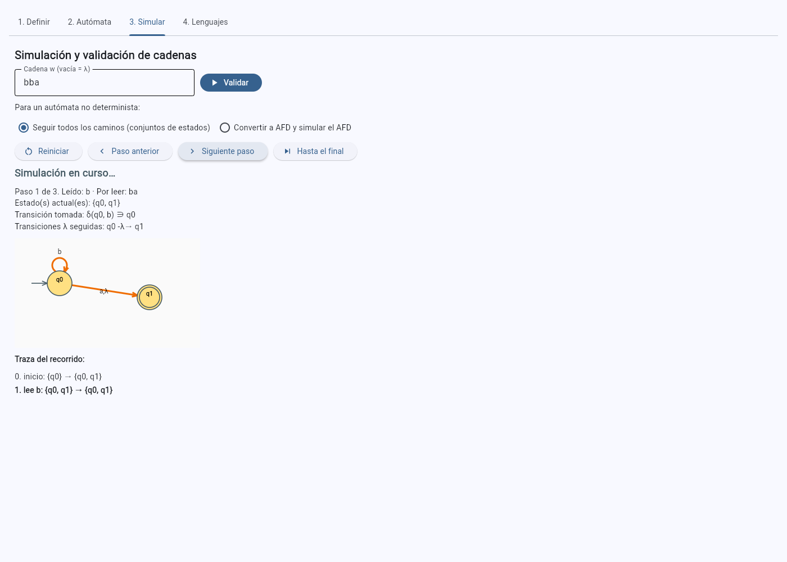
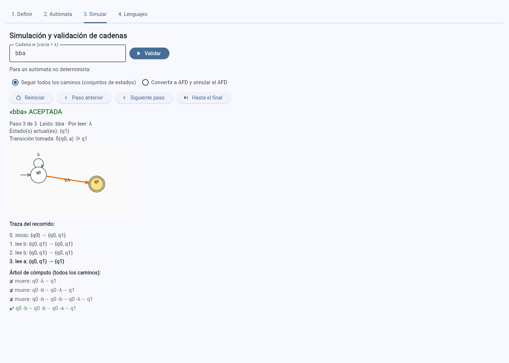
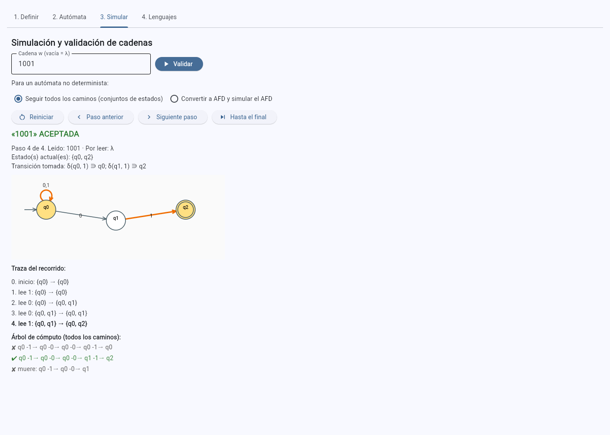
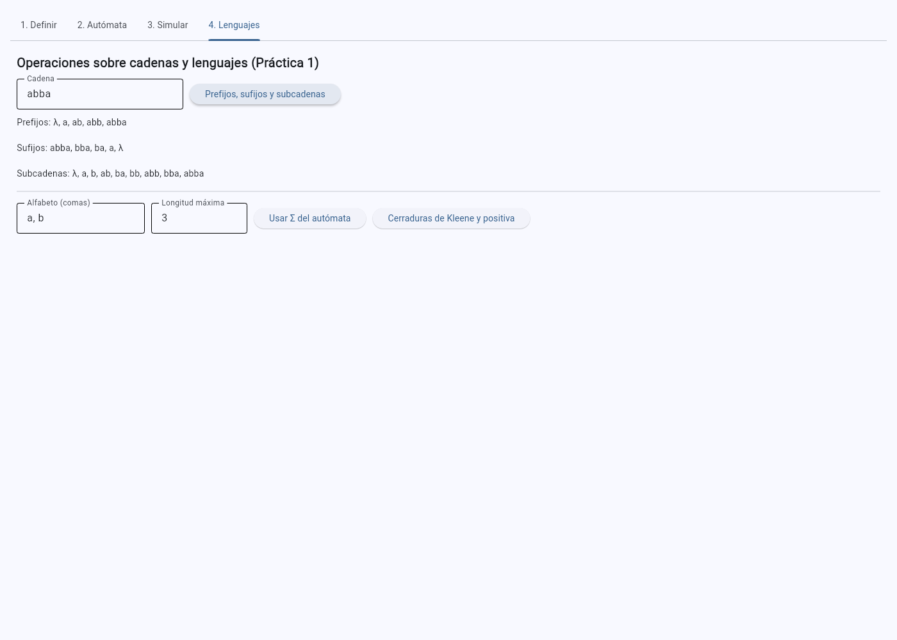
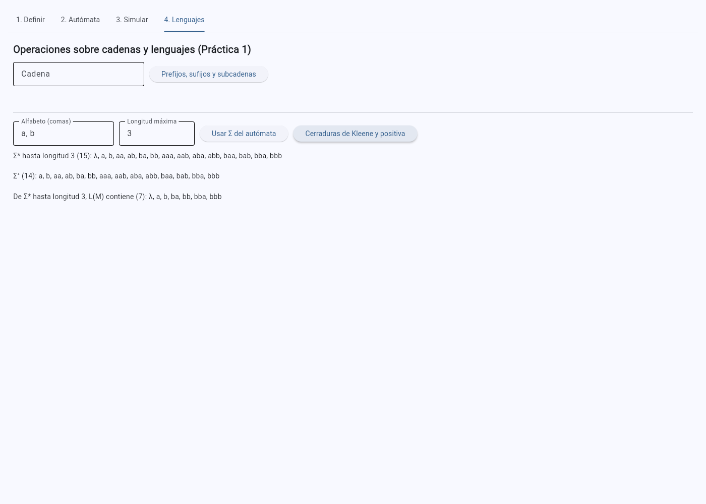

# Ejercicio 3. Simulador de autómatas con interfaz gráfica

[← Volver al índice](../README.md)

## Arquitectura: núcleo e interfaz separados

Como en la Práctica 1, la lógica no depende de Flet:

| Módulo | Responsabilidad | Depende de |
|---|---|---|
| [`src/automata.py`](../src/automata.py) | La quíntupla, la clasificación (AFD, AFND, AFND-λ), la λ-clausura, δ̂, la simulación con traza y árbol de caminos, la eliminación de λ, la construcción de subconjuntos, la minimización de Hopcroft y la comparación de lenguajes | solo la biblioteca estándar |
| [`src/formatos.py`](../src/formatos.py) | Lectura y escritura de `.jff`, `.json` y `.xml` | `automata.py`, `xml.etree`, `json` |
| [`src/lenguajes.py`](../src/lenguajes.py) | Operaciones de la Práctica 1 (sin cambios) | solo la biblioteca estándar |
| [`src/app.py`](../src/app.py) | La interfaz: controles, diagrama y eventos | los tres anteriores y Flet |

Todo lo que se prueba con pytest (`tests/`) importa solo los tres primeros módulos; `app.py` traduce lo que
escribe el usuario a llamadas del núcleo. La única función de apoyo para la interfaz que vive en el núcleo
es `desde_tabla`, que convierte el texto de las celdas de la tabla en una quíntupla y por eso se puede probar.

Se ejecuta con `python src/app.py` (ventana de escritorio) o con `docker compose up py312` (servidor web en
`http://localhost:8550`). La interfaz tiene cuatro pestañas.

## 3.1 Definición interactiva

Pestaña **1. Definir**: se escriben Σ y Q separados por comas, se elige q₀ en una lista y se marcan los estados
de F. El botón *Generar o actualizar la tabla* construye la **tabla interactiva** de δ: un renglón por estado
y una columna por símbolo, más la columna λ si se activa la casilla. Cada celda recibe los destinos separados
por comas (vacía o ∅ es el conjunto vacío), de modo que la misma tabla sirve para AFD, AFND y AFND-λ. Al
regenerar la tabla se conservan las celdas ya escritas, así que corregir la definición (agregar un estado o un
símbolo) no obliga a reescribirla. *Aplicar definición* valida la quíntupla y muestra cada error en
español (estado inicial fuera de Q, símbolo fuera de Σ, destino inexistente, λ dentro de Σ).

Pestaña **2. Autómata**: muestra el **diagrama de transiciones** dibujado con `Canvas` (estado inicial con
flecha de entrada, estados de aceptación con doble círculo, lazos, flechas curvas cuando hay ida y vuelta,
etiquetas agrupadas), la **tabla de transiciones completa**, la quíntupla en texto y las λ-clausuras. Desde
aquí se aplican las conversiones del núcleo (quitar λ, subconjuntos, Hopcroft, renombrar) y el resultado
reemplaza al autómata, listo para editarse o guardarse; un aviso indica si el lenguaje se conservó.

## 3.2 Importación

El botón *Abrir .jff / .json / .xml* usa `FilePicker`; en modo web se leen los bytes del archivo y en
escritorio su ruta. La lista *Autómatas del repositorio* carga directamente cualquiera de los `.jff` de
`automatas/`. Al importar se informa el tipo detectado y el número de estados, y la pestaña 2 muestra los cinco
componentes para verificarlos. La estructura de los tres formatos sigue el Anexo 3:

| Componente | `.jff` (JFLAP) | `.json` | `.xml` |
|---|---|---|---|
| Σ | No lo guarda JFLAP: se deduce de las transiciones. Al escribir, este proyecto agrega `<!--alfabeto: [...]-->` dentro de `<structure>`, que JFLAP ignora | `"alfabeto": [...]` | `<alfabeto><simbolo>…` |
| Q | `<state id name>` | `"estados": [...]` | `<estado nombre>` |
| q₀ | `<initial/>` | `"inicial"` | `inicial="true"` |
| F | `<final/>` | `"aceptacion": [...]` | `aceptacion="true"` |
| δ | `<transition>` con `<from>`, `<to>`, `<read>` | `{"desde", "lee", "hacia": [...]}` | `<transicion desde lee hacia/>` |
| λ | `<read/>` vacío | `"lee": ""` | `lee=""` |

**Convención para λ.** En los tres formatos λ es **la cadena vacía como símbolo leído**, la misma convención de
JFLAP. Por eso Σ nunca puede contener la cadena vacía, y el validador lo rechaza.

El lector de `.jff` tolera las coordenadas `<x>`, `<y>` (no influyen en la quíntupla), el formato antiguo sin
`<automaton>`, estados sin nombre y archivos sin el comentario de alfabeto; rechaza con un mensaje claro los
archivos de otro tipo (por ejemplo, una expresión regular de JFLAP, `<type>re</type>`), los que no tienen
estado inicial o tienen dos, y las transiciones hacia estados inexistentes.

## 3.3 Simulación y validación de cadenas

Pestaña **3. Simular**: *Validar* da el veredicto completo; *Siguiente paso*, *Paso anterior*, *Reiniciar* y
*Hasta el final* recorren la simulación. En cada paso se muestra lo leído y lo que falta, el estado o los
estados actuales, la transición tomada (δ(q, a) ∋ p), las transiciones λ seguidas y la **traza completa**
hasta ese paso; en el diagrama se colorean los estados activos y las flechas usadas. Al terminar, para un
autómata no determinista se lista el **árbol de cómputo**: cada camino, marcado como aceptado, muerto (sin
transición) o terminado fuera de F.

| Paso con λ (Anexo 3, cadena `bba`) | Validación final |
|---|---|
|  |  |

### Decisión de diseño para el no determinismo

**Se eligió simular el no determinismo siguiendo todos los caminos a la vez**, como conjunto de estados
activos (el algoritmo de Thompson, 1968): S₀ = Cl({q₀}) y Sᵢ = Cl(⋃_{q ∈ Sᵢ₋₁} δ(q, aᵢ)); la cadena se acepta
si S_n ∩ F ≠ ∅. Es la opción por defecto, y la otra queda disponible en la misma pestaña (*Convertir a AFD y
simular el AFD*) para compararlas.

Razones:

1. **Muestra lo que se quiere enseñar.** Cada paso exhibe directamente qué estados están activos y por qué
   transición llegó cada uno, incluidas las λ; con la conversión previa, el usuario vería estados como
   «{q0, q2}» sin saber de qué caminos vienen. El árbol de caminos se calcula sobre el mismo autómata.
2. **No hay explosión de estados.** La conversión puede crear hasta 2ⁿ estados (la familia Lₙ del Ejercicio 2
   lo alcanza); la simulación por conjuntos nunca guarda más de n estados a la vez.
3. **Es lineal en la cadena.** A diferencia de la exploración con retroceso, que puede tardar un tiempo
   exponencial en |w| (el problema de ReDoS que estudian Davis et al., 2018), cada símbolo se procesa una vez.

**Costo de cada alternativa** (n = |Q|, m = número de transiciones, |w| = longitud de la cadena):

| | Seguir todos los caminos | Convertir a AFD y simular |
|---|---|---|
| Preparación | Ninguna | Construcción de subconjuntos: hasta 2ⁿ estados y O(2ⁿ · \|Σ\| · n²) operaciones; en la práctica, solo los subconjuntos alcanzables |
| Costo por símbolo | O(n + m) (unión de destinos y clausura del conjunto activo) | O(1): una consulta a la tabla |
| Memoria durante la simulación | O(n) para el conjunto activo | La tabla del AFD, hasta 2ⁿ · \|Σ\| entradas |
| Total para k cadenas | O(k · \|w\| · (n + m)) | O(2ⁿ · \|Σ\| · n² + k · \|w\|) |
| Conviene cuando | Hay pocas cadenas, el autómata es grande o se quiere ver el no determinismo | Se procesan muchas cadenas con el mismo autómata y el AFD es pequeño |

## 3.4 Exportación y operaciones sobre lenguajes

*Guardar .jff*, *Guardar .json* y *Guardar .xml* escriben el autómata actual (también el resultado de una
conversión). El `.jff` incluye coordenadas calculadas por niveles de un recorrido en anchura para que JFLAP
lo dibuje legible; se comprobó que JFLAP 7.1 abre y simula estos archivos (todo el Ejercicio 2 usa archivos
escritos por `formatos.py`).

Pestaña **4. Lenguajes**: subcadenas, prefijos y sufijos de una cadena, y las cerraduras de Kleene y positiva
truncadas, con las funciones de `lenguajes.py` de la Práctica 1. Si Σ coincide con el del autómata cargado,
además lista qué cadenas de Σ* hasta esa longitud pertenecen a L(M).

| Cadenas | Cerraduras y L(M) |
|---|---|
|  |  |

## 3.5 Pruebas

La suite de pytest tiene cinco archivos:

| Archivo | Qué cubre |
|---|---|
| [`tests/test_lenguajes.py`](../tests/test_lenguajes.py) | Las operaciones de la Práctica 1 (sin cambios) |
| [`tests/test_automata.py`](../tests/test_automata.py) | **Aceptación y rechazo en un AFD** (problema 139); AFND y su árbol de caminos; **aceptación en un AFND-λ que requiere la λ-clausura** (la cadena `b` del Anexo 3 solo se acepta porque Cl(q0) contiene a q1, y `aabb` en a*b* exige cruzar la λ); ciclos λ; eliminación de λ; subconjuntos; Hopcroft; la familia Lₙ con 2ⁿ estados; validación |
| [`tests/test_formatos.py`](../tests/test_formatos.py) | **Exportación e importación de un mismo autómata en los tres formatos como operaciones inversas** (`leer(escribir(M)) == M` y `escribir(leer(texto)) == texto`), lectura de los tres archivos del Anexo 3, cruces entre formatos, disco y archivos mal formados |
| [`tests/test_catalogo.py`](../tests/test_catalogo.py) | Cada autómata del Ejercicio 2: sus tres archivos coinciden, acepta exactamente el lenguaje del oráculo y cada conversión es equivalente |
| [`tests/test_aplicacion.py`](../tests/test_aplicacion.py) | El autómata de TCP del Ejercicio 5 desde sus tres archivos y sus 17 casos |

Resultado: las mismas pruebas aprueban en los tres contenedores
([`evidencias/ci/pytest-contenedores.txt`](../evidencias/ci/pytest-contenedores.txt)) y en GitHub Actions
con Python 3.11, 3.12 y 3.13 ([`evidencias/ci/actions.png`](../evidencias/ci/actions.png)).
