# Práctica 3 · Ejercicio 2. Extensión del software interactivo

[← Volver al índice](../../README.md)

## Arquitectura

Se conserva la separación de la Práctica 2: el núcleo no importa Flet y se prueba sin abrir la interfaz.

| Módulo | Responsabilidad nueva |
|---|---|
| [`src/algoritmos.py`](../../src/algoritmos.py) | Los cinco algoritmos del ejercicio, cada uno con su **registro paso a paso** (las filas de la tabla en el orden en que se generan, las rondas de la partición, las transiciones añadidas) y el número de consultas a δ que hizo. Sólo depende de `automata.py` y de la biblioteca estándar |
| [`src/app.py`](../../src/app.py) | La pestaña nueva **5. Paso a paso**, la simulación directa con los activos antes y después de la cerradura, y la validación de un archivo de cadenas. No contiene ninguna regla de los algoritmos: sólo muestra el registro que le entrega el núcleo |
| [`tests/test_practica3.py`](../../tests/test_practica3.py) | Las pruebas del apartado 2.6 |

Los algoritmos de `automata.py` de la Práctica 2 (`sin_lambda`, `subconjuntos`, `minimizar` de Hopcroft) se
conservan sin cambios y sirven de referencia independiente: las pruebas comprueban que las versiones paso a paso
dan el mismo autómata.

Todo se aplica a los autómatas importados desde `.jff` (pestaña 1, *Abrir .jff / .json / .xml* o la lista
*Autómatas del repositorio*). Los casos de prueba de la Lista 3 están copiados en
[`automatas/practica3/casos-de-prueba/`](../../automatas/practica3/casos-de-prueba/):

| Apartado | Casos | Archivos |
|---|---|---|
| 2.1 | Lista 3, 196-200 (AFN-λ) | `L3-196.jff` … `L3-200.jff` |
| 2.3 | Lista 3, 191-194 y 260-263 (AFN) | `L3-192-AFND.jff` … `L3-194-AFND.jff`, `L3-260-AFND.jff` … `L3-263-AFND.jff` |
| 2.4 | Lista 3, 151-157 (AFD) | `L3-151-original.jff` … `L3-157-original.jff` |

El 191 no tiene autómata propio: es el planteamiento común de los problemas 192-194 («dado el AFN de cada
tabla, encuentre un AFD equivalente»), así que sus casos son los tres AFN de esos problemas.

Las capturas se tomaron con la aplicación en modo web y
[`herramientas/capturas_p3.py`](../../herramientas/capturas_p3.py), que hace los mismos clics que un usuario.

## 2.1 Cerradura λ y simulación directa

**Cerradura λ.** `clausura_lambda(aut, q)` calcula Cl(q) con un recorrido en profundidad con pila explícita y
registra cada estado que saca de la pila, sus transiciones λ y qué estados agrega; `clausuras(aut)` la calcula
para todos los estados. En la pestaña 5 se elige *2.1 Cerradura λ* y el estado en *Estado para Cl(q)*; cada
*Siguiente paso* avanza un movimiento de la pila y colorea en el diagrama los estados que ya están en la
cerradura y las transiciones λ seguidas. El último paso muestra la tabla de las cerraduras de todos los
estados, con el renglón del estado elegido resaltado.

| Paso intermedio: Cl(A) en el 197 | Resultado y cerraduras de todos los estados |
|---|---|
| 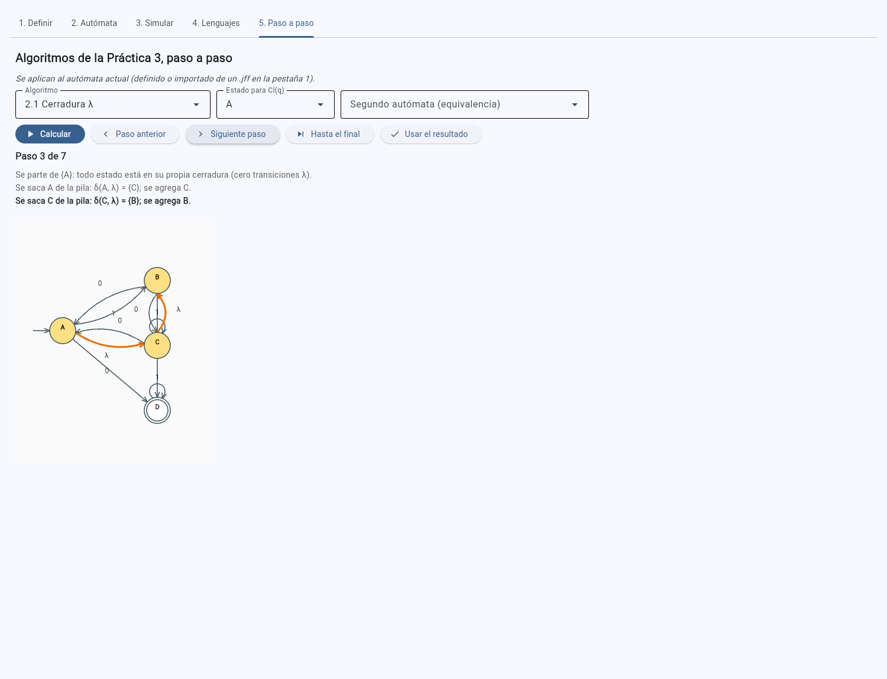 | 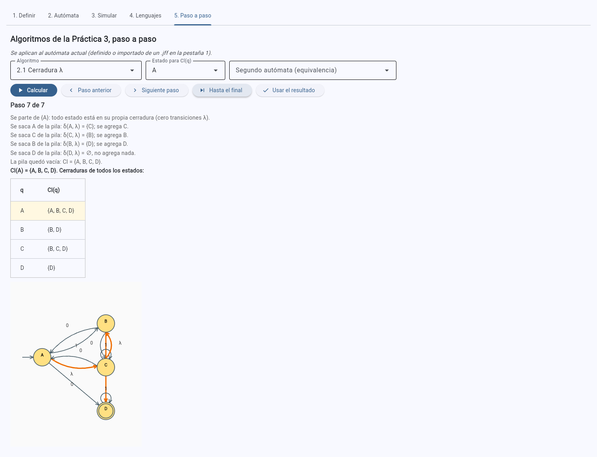 |

**Simulación directa.** `simular_directo(aut, w)` simula el AFN-λ sin convertirlo: S₀ = Cl({q₀}) y
Sᵢ = Cl(δ(Sᵢ₋₁, aᵢ)). Cada paso guarda los activos de partida, el conjunto **antes de aplicar la cerradura**
(δ(Sᵢ₋₁, aᵢ)), el conjunto **después** (Sᵢ), las transiciones tomadas y las λ seguidas. En la pestaña 3 la
opción por defecto es *Simulación directa*; cada paso muestra la línea «Activos antes de la cerradura λ: … ·
después de la cerradura λ: …». La Práctica 2 ya simulaba por conjuntos (no por conversión a AFD), así que esto
completa esa simulación con el conjunto intermedio. La opción *Convertir a AFD y simular el AFD* se conserva
para compararlas.

| 197 con `010`, paso 2: antes {A, C, D}, después {A, B, C, D} | Veredicto |
|---|---|
| 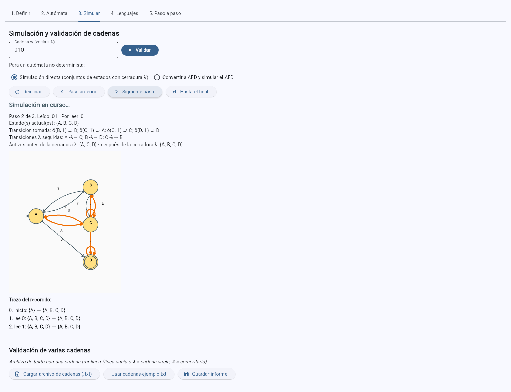 | 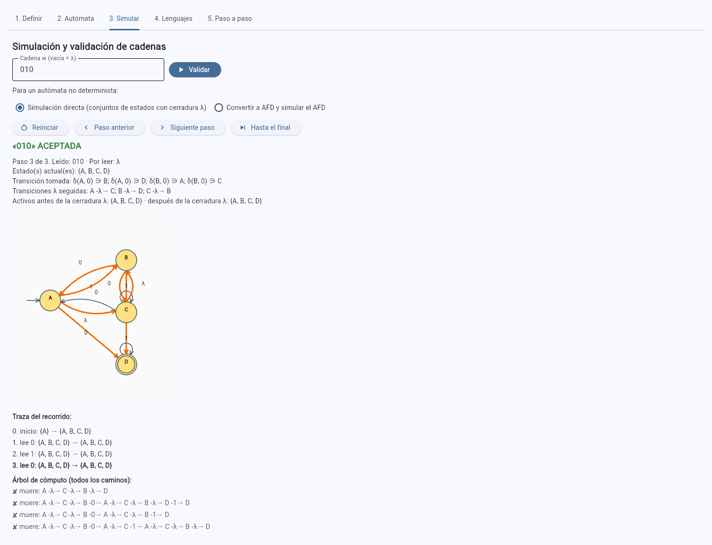 |

Casos de prueba: 196-200. Las cerraduras pedidas en los incisos de la lista se comprueban en
`test_clausuras_de_la_lista` y la simulación de todas las cadenas de longitud ≤ 6 de los cinco AFN-λ en
`test_simulacion_directa_coincide_con_delta_gorro` (el último conjunto debe ser δ̂(q₀, w) y cada «después»
debe ser la cerradura de su «antes»).

## 2.2 Eliminación de transiciones λ

`eliminar_lambda(aut)` construye δ'(q, a) = Cl(δ(Cl(q), a)) y F' = {q : Cl(q) ∩ F ≠ ∅}, con los mismos
estados. El resultado registra, para cada estado, Cl(q), el conjunto δ(Cl(q), a) y su cerradura; las
**transiciones que se añaden** (las de δ' que no estaban en δ), las λ que se quitan y los **estados que pasan a
ser de aceptación**. En la interfaz, el primer paso lista las cerraduras y cada paso siguiente agrega un
renglón a la tabla de δ', diciendo qué transiciones se añadieron por ese estado y si se volvió de aceptación.
El último paso dibuja el AFN sin λ con las transiciones añadidas resaltadas.

| 199, renglón de C: se añaden C -1→ B, C -1→ D, C -1→ E y C pasa a F' | Resultado: 8 transiciones añadidas, A y C pasan a F' |
|---|---|
| 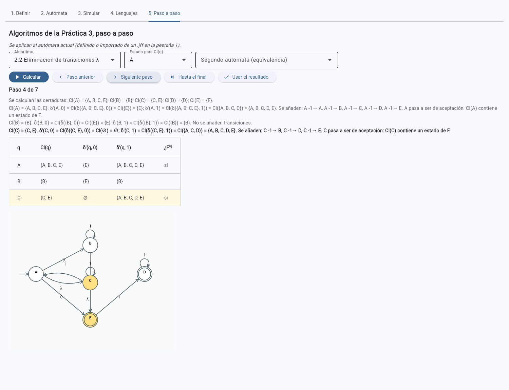 | 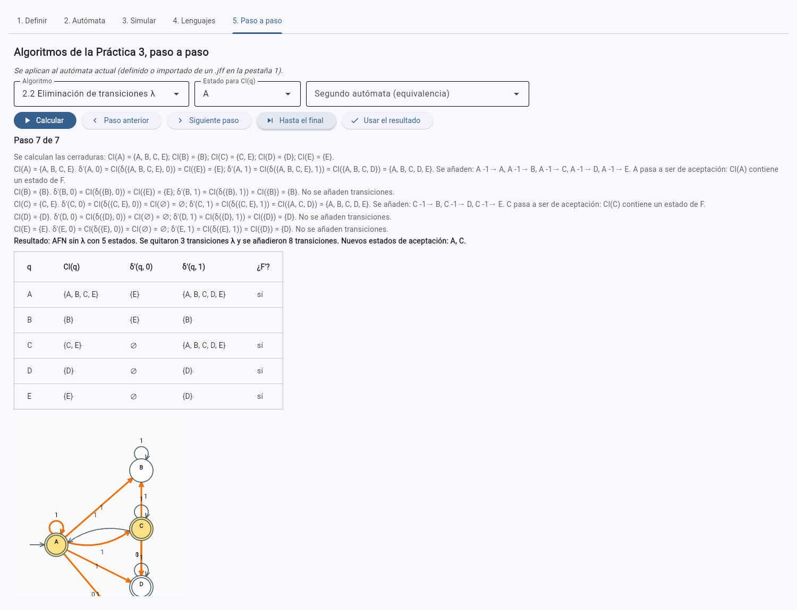 |

## 2.3 Construcción de subconjuntos

`construir_subconjuntos(aut)` parte de {q₀} (de Cl({q₀}) si hay λ) y procesa una cola: sólo se crean los
subconjuntos **alcanzables**. Cada renglón registra δ_D(S, a) para cada símbolo, los subconjuntos nuevos que
descubrió y por qué es o no de aceptación (S ∩ F). El conjunto vacío es el estado sumidero ∅, para que δ_D
sea total, como exige la definición de AFD del curso. En la pestaña 5 la tabla del AFD crece un renglón por
paso, con el renglón actual resaltado y sus estados del AFN coloreados en el diagrama; al final se dibuja el
AFD y se indica cuántos de los 2ⁿ subconjuntos resultaron alcanzables.

| 193, renglón 3: {B, C} descubre {A, C, D} y {A, B, C, D} | AFD completo (8 de 16 subconjuntos) |
|---|---|
| 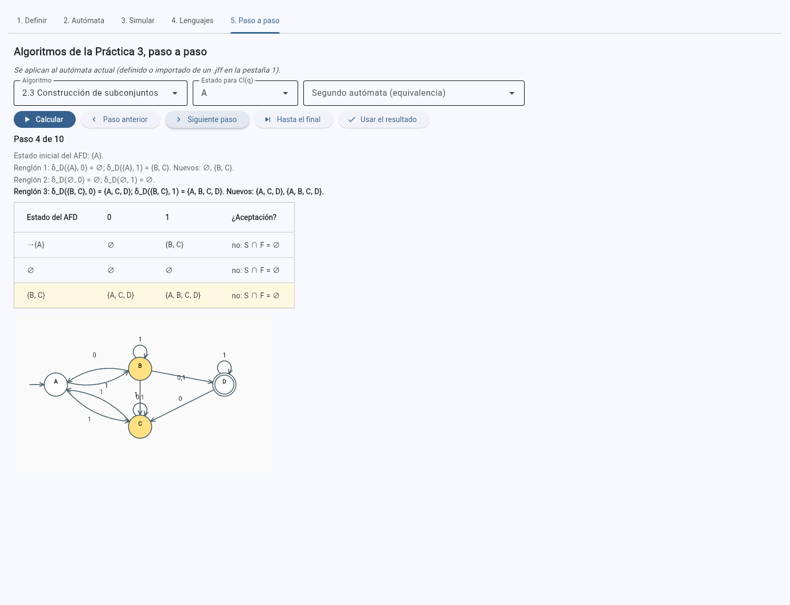 | 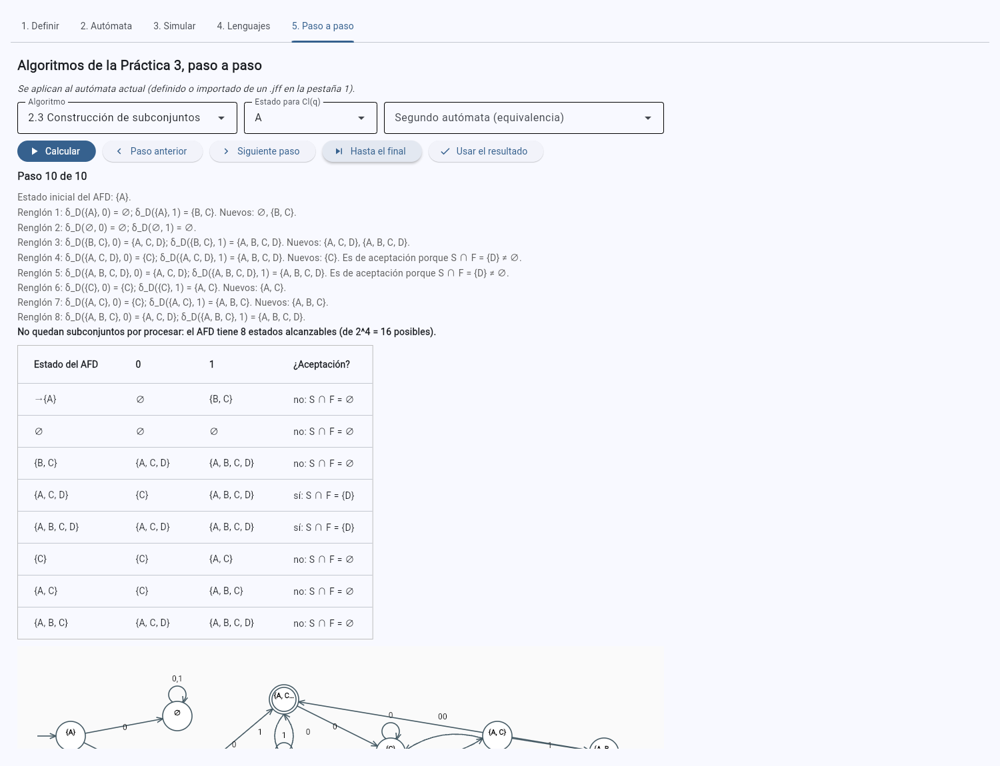 |

Casos de prueba: 192-194 y 260-263. `test_tabla_de_subconjuntos` revisa que cada renglón procese un subconjunto
ya descubierto (alcanzable) y que la aceptación sea exactamente S ∩ F ≠ ∅; `test_subconjuntos_coincide_con_la_practica2`
compara con la construcción de la Práctica 2, y `test_subconjuntos_192_tabla_conocida`, con el AFD que obtuvo
*Convert to DFA* de JFLAP para el 192.

## 2.4 Minimización de AFD y equivalencia

`minimizar_afd(aut)` (1) elimina los estados inaccesibles con un recorrido en anchura, (2) agrega un sumidero
si δ es parcial y (3) refina la partición Π₀ = {F, Q − F}: en cada ronda, dos estados de un bloque siguen
juntos sólo si van, con cada símbolo, al mismo bloque de la ronda anterior. Termina cuando una ronda no divide
ningún bloque. Cada ronda guarda la partición y, para cada bloque que se divide, a qué bloques va cada parte
(su «firma»). La interfaz muestra los inaccesibles, una tabla de bloques por ronda y, al final, el AFD mínimo,
cuyos estados se llaman como su bloque, entre corchetes (`[A, J]`), para no confundirlos con los estados del
AFD de subconjuntos (`{A, B}`).

| 155: Π₁ separa [E, K] | Resultado: 12 estados → 5 (sin I y L, inaccesibles) |
|---|---|
| 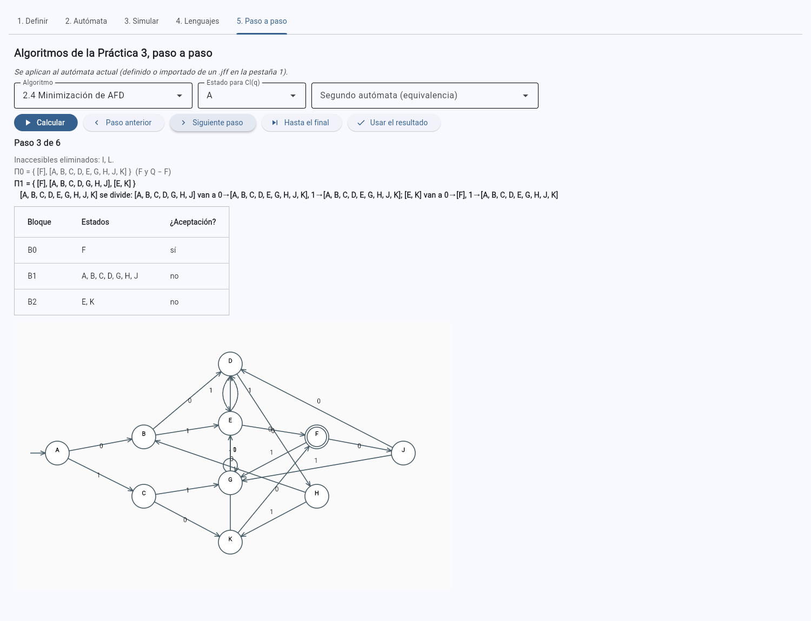 | 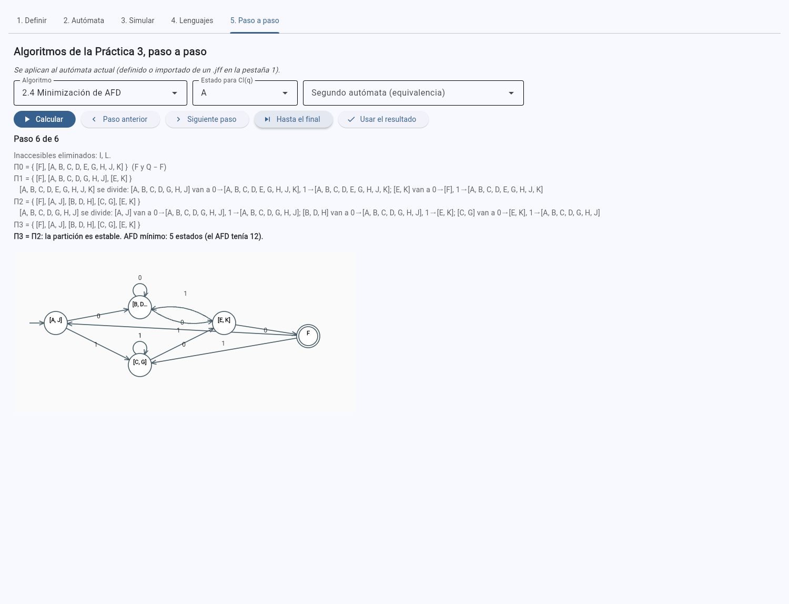 |

**Equivalencia.** `equivalentes_por_minimizacion(a1, a2)` lleva los dos autómatas a su AFD mínimo (con
eliminación de λ y subconjuntos si no son deterministas) y busca un isomorfismo con `isomorfismo(m1, m2)`:
recorre los dos AFD a la par desde los iniciales; como δ es una función, cada estado tiene un único candidato,
y basta comprobar que la correspondencia sea biyectiva y respete F. Son equivalentes si y sólo si los mínimos
coinciden salvo el nombre de los estados. En la pestaña 5 se elige *2.4 Equivalencia de dos autómatas* y el
segundo autómata en la lista.

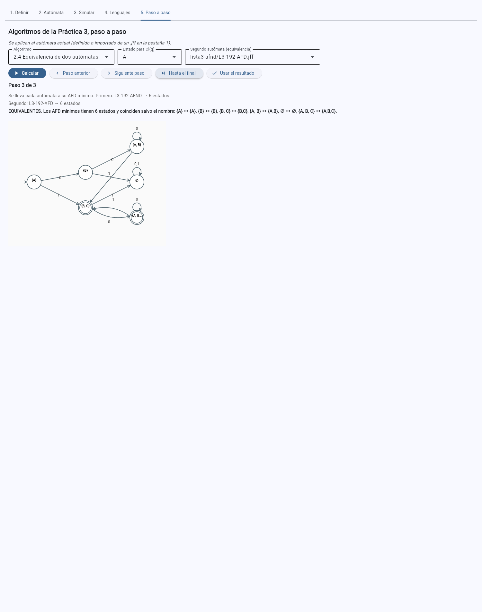

Casos de prueba: 151-157. Para cada uno se comprueban los inaccesibles y el número de estados del mínimo
(`test_minimizacion_151_157`) y que el mínimo es **equivalente por isomorfismo** al AFD simplificado que se
entregó en la Práctica 1 (`test_minimo_contra_el_simplificado_de_la_lista`). Además, la decisión de
equivalencia por minimización coincide con la búsqueda de contraejemplo de la Práctica 2 en todos los pares con el mismo alfabeto
formados con los primeros ocho casos (`test_equivalencia_coincide_con_contraejemplo`).

| Caso | Estados | Inaccesibles | Rondas | Estados del mínimo |
|---|---|---|---|---|
| 151 | 10 | — | 4 | 5 |
| 152 | 6 | — | 4 | 5 |
| 153 | 7 | — | 3 | 6 |
| 154 | 11 | J | 4 | 7 |
| 155 | 12 | I, L | 4 | 5 |
| 156 | 5 | — | 3 | 3 |
| 157 | 6 | — | 3 | 4 |

(«Rondas» cuenta Π₀ y la ronda final que confirma que la partición es estable.)

## 2.5 Validación de varias cadenas

`leer_cadenas(texto)` toma una cadena por línea (una línea vacía o con `λ` es la cadena vacía; las que
empiezan con `#` son comentarios); `validar_lote(aut, texto)` simula cada una con la simulación directa e
indica los símbolos fuera de Σ, y `informe_lote` escribe el informe. En la pestaña 3, *Cargar archivo de
cadenas (.txt)* abre el archivo, la tabla muestra el resultado de cada cadena y *Guardar informe* guarda el
texto. *Usar cadenas-ejemplo.txt* carga [`automatas/practica3/cadenas-ejemplo.txt`](../../automatas/practica3/cadenas-ejemplo.txt).

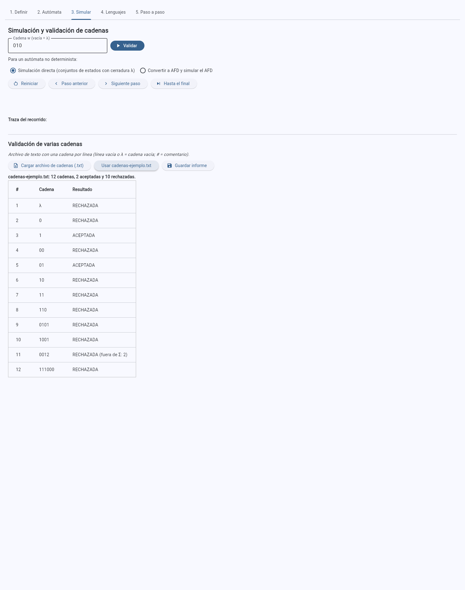

Informe generado: [`evidencias/practica3/informe-L3-196.txt`](../../evidencias/practica3/informe-L3-196.txt).

## 2.6 Pruebas automatizadas

[`tests/test_practica3.py`](../../tests/test_practica3.py) recorre los 19 casos (5 AFN-λ, 7 AFN y 7 AFD) y, para
cada uno, construye la cadena original → AFN sin λ → AFD de subconjuntos → AFD mínimo
(`de_afn_lambda_a_minimo`) y comprueba que:

1. **los cuatro aceptan exactamente las mismas cadenas** de Σ⁰ ∪ Σ¹ ∪ … ∪ Σ⁸;
2. el AFD mínimo **no tiene más estados** que el AFD de subconjuntos del que procede;
3. cada etapa tiene el tipo correcto (sin λ, AFD completo), el mínimo coincide con el de Hopcroft de la
   Práctica 2 salvo nombres, y volver a minimizarlo no quita estados.

**Por qué longitud 8.** Una comparación sobre cadenas cortas podría, en principio, pasar por alto una
diferencia en cadenas largas. Aquí no: cada autómata, simulado por conjuntos, tiene en cada momento un
conjunto Sᵢ de estados activos, y su veredicto depende sólo de Sᵢ. Si se simulan los cuatro a la vez, el
estado conjunto es la tupla (S₁, S₂, S₃, S₄), y hay un número finito de tuplas alcanzables. Sea d la mayor
distancia, en símbolos, desde la tupla inicial a una tupla alcanzable (la profundidad del recorrido en
anchura, `profundidad_producto`). Toda tupla alcanzable se alcanza con una cadena de longitud ≤ d, así que si
los cuatro coinciden en todas las cadenas de longitud ≤ d, coinciden en todas las cadenas. En los 19 casos
d ≤ 5 (el máximo es el 193), y `test_la_longitud_elegida_es_suficiente` lo comprueba; L = 8 deja margen y
hace que la prueba sea **exhaustiva**, no una muestra. El costo es pequeño: 511 cadenas sobre un alfabeto de
dos símbolos (9 841 en el 152 y el 194, de tres símbolos) por autómata.

Además se prueban las cerraduras de los incisos de la lista, la simulación directa, las transiciones
añadidas y los estados de aceptación nuevos de la eliminación de λ, la tabla de subconjuntos, los inaccesibles
y los tamaños de la minimización, el isomorfismo (incluido un caso con el mismo grafo y distinto F), la
lectura del archivo de cadenas y el informe. Resultado: **950 pruebas** en total (183 nuevas), aprobadas con
Python 3.11, 3.12 y 3.13 en la integración continua
([`.github/workflows/pruebas.yml`](../../.github/workflows/pruebas.yml)); la evidencia está en
[`evidencias/practica3/ci/`](../../evidencias/practica3/ci/).
