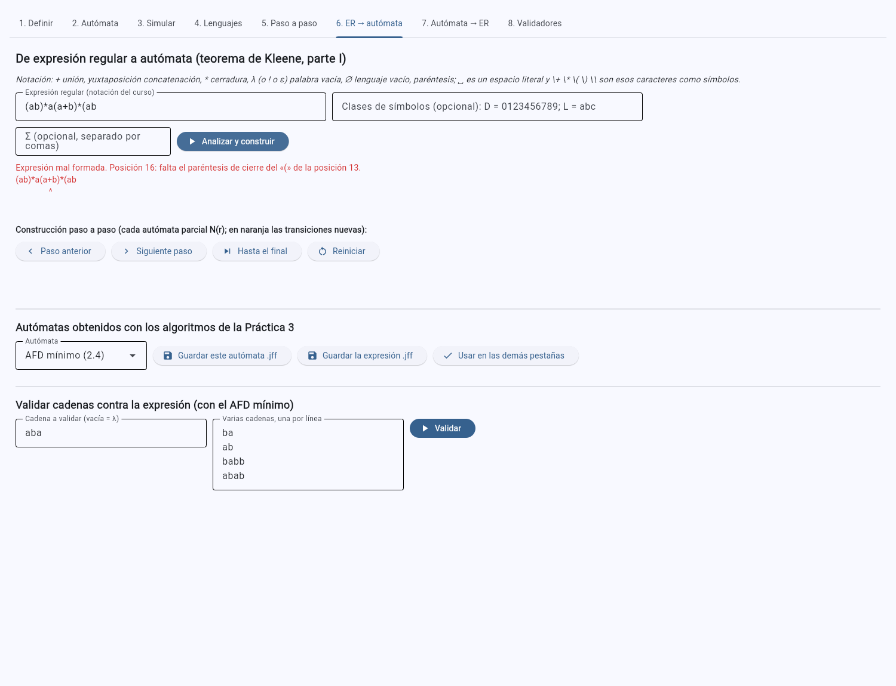
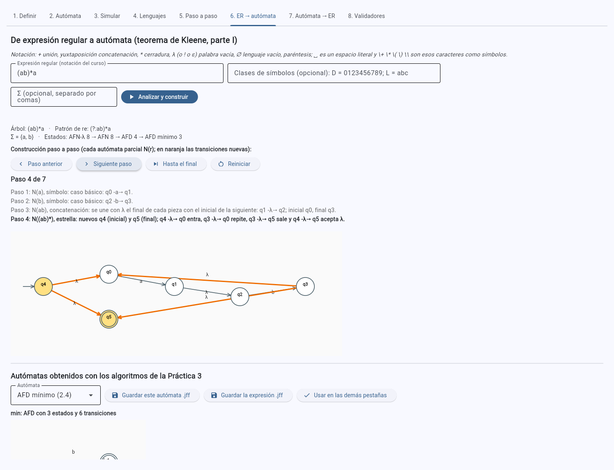
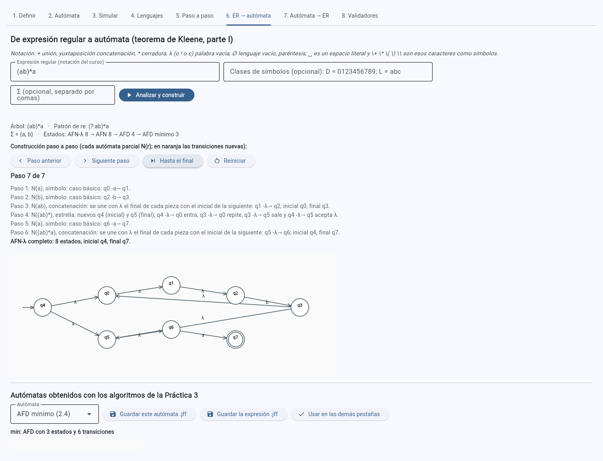
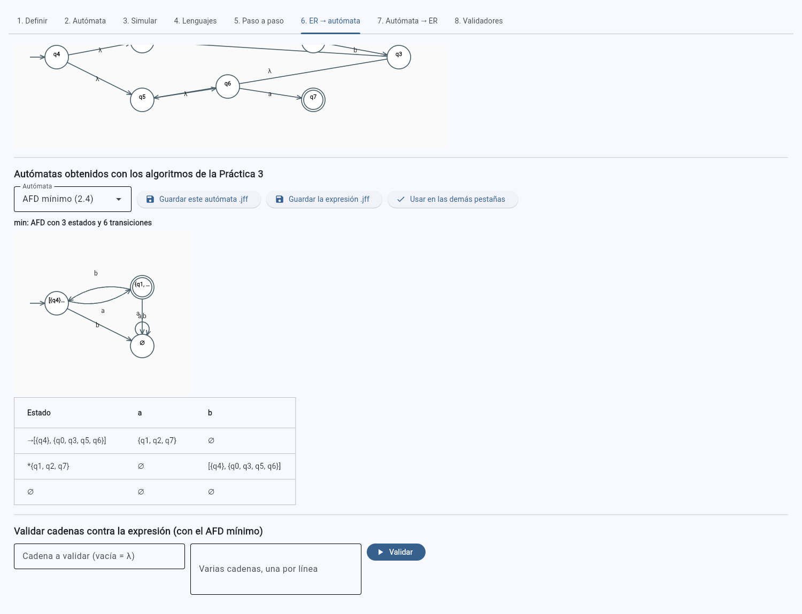
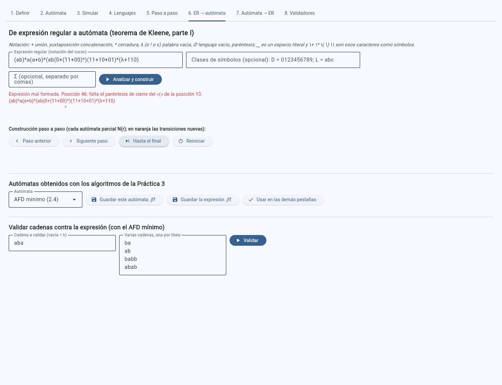
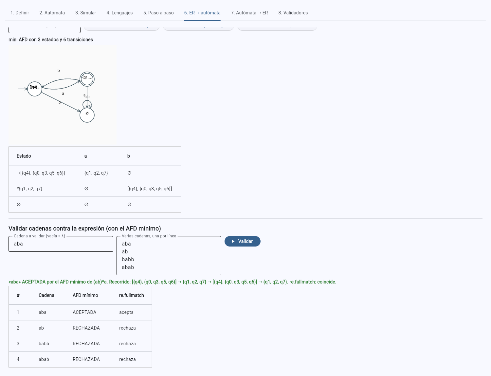

# Práctica 4 · Ejercicio 2. De expresión regular a autómata

[← Volver al índice](../../README.md)

## Arquitectura

Se conserva la separación de las Prácticas 2 y 3: el núcleo no importa Flet y se prueba sin abrir la interfaz.

| Módulo | Responsabilidad nueva |
|---|---|
| [`src/expresiones.py`](../../src/expresiones.py) | El analizador de la notación del curso (`analizar`), la construcción del AFN-λ con su registro paso a paso (`construir_afn`), la cadena completa hasta el AFD mínimo reutilizando `algoritmos.py` (`de_expresion_a_minimo`), la eliminación de estados del Ejercicio 3, la comparación de expresiones y la traducción a `re` |
| [`src/app.py`](../../src/app.py) | La pestaña **6. ER → autómata**: analiza, muestra el error con su posición, recorre la construcción paso a paso, muestra y exporta cada autómata y valida cadenas |
| [`tests/test_practica4.py`](../../tests/test_practica4.py) | Los casos de prueba del enunciado |
| [`herramientas/practica4_generar.py`](../../herramientas/practica4_generar.py) | Genera los `.jff` de [`automatas/practica4/`](../../automatas/practica4/) y la tabla [`resultados.md`](../../automatas/practica4/resultados.md) |

Las capturas se tomaron con la aplicación en modo web y
[`herramientas/capturas_p4.py`](../../herramientas/capturas_p4.py), que hace los mismos clics que un usuario.

## 2.1 Análisis de la expresión

**Notación aceptada.** La del curso, tal como la fija el enunciado:

| Se escribe | Significa |
|---|---|
| `+` | unión |
| yuxtaposición | concatenación |
| `*` | cerradura de Kleene (precedencia más alta; después la concatenación y al final la unión) |
| `λ`, también `ε` o `!` (la forma de JFLAP) | palabra vacía |
| `∅`, también `Ø` | lenguaje vacío |
| `( )` | agrupación |
| espacios | se ignoran (`0 + 1` es `0+1`) |
| `␣` | un espacio como símbolo del alfabeto |
| `\+` `\*` `\(` `\)` `\\` | esos caracteres como símbolos del alfabeto (p. ej. los paréntesis de un teléfono) |
| cualquier otro carácter | un símbolo del alfabeto: `.`, `@`, `/`, `-`, `:`, `?` o `#` no son operadores |
| una letra declarada como **clase** | abreviatura de una unión de símbolos: `D = 0+1+…+9` hace que `D` sea `(0+1+…+9)` |

Las clases se declaran en el campo *Clases de símbolos* de la pestaña 6 (`D = 0123456789; L = abc…`) o en el
argumento `clases` de `analizar`. Son la abreviatura que permite el enunciado para alfabetos grandes; los
validadores del Ejercicio 4 las usan.

**Gramática.** `analizar` es un analizador de descenso recursivo con una función por nivel de precedencia:

```
union    → concat ('+' concat)*
concat   → estrella estrella*          (mientras siga un símbolo, λ, ∅ o '(')
estrella → atomo '*'*
atomo    → símbolo | clase | λ | ∅ | '(' union ')'
```

El resultado es un árbol de nodos inmutables (`Simbolo`, `Clase`, `Lambda`, `Vacio`, `Union`, `Concat`,
`Estrella`) que se imprime de vuelta con los paréntesis mínimos: `str(analizar("(0+1)*1"))` es `(0+1)*1` y
`str(analizar("a+bc*"))` es `a+bc*`. La prueba `test_el_texto_del_arbol_se_vuelve_a_analizar` comprueba
que `analizar(str(arbol)) == arbol` en todos los casos de prueba.

**Errores con posición.** Cada ficha guarda el índice del carácter en el texto original (desde 1, contando los
espacios). Una expresión mal formada lanza `ErrorDeSintaxis` con el mensaje, la posición y el método
`senalar()`, que dibuja un acento circunflejo bajo el carácter; la pestaña 6 muestra las dos cosas:

| Expresión | Mensaje |
|---|---|
| `a+` | Posición 3: se esperaba un símbolo, λ, ∅ o «(» y se encontró el final de la expresión. |
| `*a` | Posición 1: la cerradura * no tiene operando a su izquierda. |
| `a++b` | Posición 3: la unión + no tiene operando a su izquierda. |
| `(ab` | Posición 4: falta el paréntesis de cierre del «(» de la posición 1. |
| `ab)` | Posición 3: paréntesis de cierre sin su paréntesis de apertura. |
| `()` | Posición 2: paréntesis vacíos: falta la expresión entre ( y ). |
| (vacía) | Posición 1: la expresión está vacía. |



## 2.2 Construcción del AFN-λ (parte I del teorema de Kleene)

`construir_afn(arbol)` recorre el árbol en posorden y aplica las construcciones de Hopcroft et al. (2007,
teorema 3.7, figuras 3.16 y 3.17) y Sipser (2013, lema 1.55). Cada N(r) tiene **un solo estado inicial sin
transiciones de entrada y un solo estado final sin transiciones de salida**, que es lo que permite combinarlos
sin interferencias (es justo lo que falla en la «construcción ahorradora» del problema 274 de la Lista 4):

| Caso | Construcción | Estados nuevos |
|---|---|---|
| N(a) | i -a→ f | 2 |
| N(λ) | i -λ→ f | 2 |
| N(∅) | i y f sin transiciones: ninguna cadena llega a f | 2 |
| N(D), clase D = {d₁, …, dₖ} | i -dⱼ→ f para cada dⱼ (la unión de los k casos básicos, sin los estados intermedios que la eliminación de λ quitaría) | 2 |
| N(r + s) | nuevo i con λ hacia los iniciales de N(r) y N(s); λ desde sus finales hacia el nuevo f | 2 |
| N(rs) | el final de N(r) se une con λ al inicial de N(s); el inicial es el de N(r) y el final el de N(s) | 0 |
| N(r*) | nuevos i y f; i -λ→ iᵣ (entrar), fᵣ -λ→ iᵣ (repetir), fᵣ -λ→ f (salir) e i -λ→ f (aceptar λ) | 2 |

Los estados se numeran q0, q1, … en el orden en que se crean, de modo que la numeración coincide con la de
las construcciones a mano de la Lista 4. Cada paso guarda la regla, la subexpresión N(r), el autómata parcial
(solo sus estados), sus estados inicial y final y las transiciones añadidas; la pestaña 6 los recorre con
*Siguiente paso* y resalta en naranja las transiciones nuevas.

**Ejemplo: `(ab)*a` (Lista 4, 272 b).**

| Paso | N(r) | Regla | Inicial → final | Transiciones añadidas |
|---|---|---|---|---|
| 1 | N(a) | símbolo | q0 → q1 | q0 -a→ q1 |
| 2 | N(b) | símbolo | q2 → q3 | q2 -b→ q3 |
| 3 | N(ab) | concatenación | q0 → q3 | q1 -λ→ q2 |
| 4 | N((ab)*) | estrella | q4 → q5 | q4 -λ→ q0, q4 -λ→ q5, q3 -λ→ q0, q3 -λ→ q5 |
| 5 | N(a) | símbolo | q6 → q7 | q6 -a→ q7 |
| 6 | N((ab)*a) | concatenación | q4 → q7 | q5 -λ→ q6 |

| Paso 4: N((ab)*) con sus cuatro λ nuevas | Paso 6: el AFN-λ completo (8 estados) |
|---|---|
|  |  |

Es exactamente el autómata entregado en la Lista 4 (`automatas/practica4/lista4/272b.jff`, hecho en JFLAP):
mismos 8 estados y mismo lenguaje, y la cerradura Cl(q4) = {q0, q4, q5, q6} coincide con la calculada a mano
(`test_pasos_de_la_construccion_272b`).

## 2.3 Del AFN-λ al AFD mínimo con los algoritmos de la Práctica 3

`de_expresion_a_minimo` encadena, sin cambios, `eliminar_lambda` (§ 2.2 de la Práctica 3),
`construir_subconjuntos` (§ 2.3) y `minimizar_afd` (§ 2.4). La pestaña 6 muestra el número de estados de cada
etapa y permite elegir cuál ver (diagrama y tabla), **guardar cada uno en `.jff`**, guardar la expresión en el
formato de expresión de JFLAP (`<type>re</type>`, con `!` por λ) y pasar el autómata elegido a las demás
pestañas (para simularlo en la 3 o recorrer el algoritmo paso a paso en la 5).

| Después de *Hasta el final*: etapa AFD mínimo de `(ab)*a` | El AFD mínimo del 253, 18 estados |
|---|---|
|  |  |

**Casos de prueba.** Para cada expresión, [`automatas/practica4/casos-de-prueba/er/`](../../automatas/practica4/casos-de-prueba/er/)
contiene `<caso>-ER.jff`, `<caso>-afn-lambda.jff`, `<caso>-afn.jff`, `<caso>-afd.jff` y `<caso>-min.jff`,
todos generados por el software con `herramientas/practica4_generar.py`:

| Caso | Expresión | AFN-λ | AFN | AFD | AFD mínimo |
|---|---|---|---|---|---|
| L3-241 | `0+1` | 6 | 6 | 4 | 3 |
| L3-242 | `0*+1` | 8 | 8 | 4 | 4 |
| L3-243 | `(0+1)*` | 8 | 8 | 3 | 1 |
| L3-244 | `0(0+1)` | 8 | 8 | 5 | 4 |
| L3-245 | `0(0+1)*` | 10 | 10 | 5 | 3 |
| L3-246 | `0*(0+1)` | 10 | 10 | 4 | 4 |
| L3-247 | `(01)*+1*` | 12 | 12 | 5 | 5 |
| L3-248 | `(0*+1)0` | 10 | 10 | 5 | 5 |
| L3-249 | `(0*+1)0*` | 12 | 12 | 5 | 3 |
| L3-250 | `0*1*+1*0` | 16 | 16 | 7 | 6 |
| L3-251 | `(0+1*)0+1*1` | 18 | 18 | 5 | 5 |
| L3-252 | `(0+1)*(00+11)+(00+11)(0+1)*` | 38 | 38 | 13 | 8 |
| L3-253 | `(0+(11+00)*)(11+10+01)*(λ+110)` | 42 | 42 | 23 | 18 |
| L4-272a | `a+b*` | 8 | 8 | 4 | 4 |
| L4-272b | `(ab)*a` | 8 | 8 | 4 | 3 |
| L4-272c | `(a+b)*abb` | 14 | 14 | 5 | 4 |
| L4-272d | `a(ba)*+b` | 12 | 12 | 6 | 5 |
| L4-272e | `(a+λ)(b+∅)` | 12 | 12 | 4 | 4 |
| L4-278 | `(a+b)*b` | 10 | 10 | 3 | 2 |

El AFN sin λ tiene siempre los mismos estados que el AFN-λ (la eliminación de λ no quita estados, solo
transiciones), el AFD de subconjuntos solo tiene los alcanzables (incluido el sumidero ∅ cuando hace falta) y
el mínimo nunca tiene más. En el 243, `(0+1)*`, el mínimo tiene un solo estado: todo Σ* se acepta. En el 272 e,
la rama N(∅) nunca llega a su final, así que L = (a + λ)b = {b, ab}: la expresión con ∅ se construye tal cual
(aparece su paso) y es la eliminación de λ y la minimización las que la descartan. El 278 es el «ciclo
completo» de la Lista 4: AFN-λ de 10 estados → AFD de 3 → mínimo de 2, los mismos que se obtuvieron en JFLAP
(`automatas/practica4/lista4/278_*.jff`), y la expresión que la pestaña 7 recupera del mínimo,
`(a+bb*a)*bb*`, es equivalente a la original.

## 2.4 Validación de cadenas

La pestaña 6 valida una cadena o una lista (una por línea) **con el AFD mínimo**, muestra el recorrido de
estados y, como comprobación, el veredicto de `re.fullmatch` con el patrón traducido. Lista 4, problema 273,
sobre los autómatas de 272 b y 272 c:

| Cadena | `(ab)*a` | `(a+b)*abb` |
|---|---|---|
| aba | aceptada | rechazada |
| ab | rechazada | rechazada |
| babb | rechazada | aceptada |
| abab | rechazada | rechazada |



Los veredictos coinciden con los de la Lista 4, que se obtuvieron a mano por cerraduras λ; la prueba
`test_273_cadenas_por_clausuras` los comprueba sobre el AFN-λ con la simulación directa de la Práctica 3 y
verifica que los conjuntos intermedios de `aba` en 272 b son {q0, q4, q5, q6} → {q1, q2, q7} →
{q0, q3, q5, q6} → {q1, q2, q7}, los mismos de la solución a mano.

## 2.5 Pruebas

`tests/test_practica4.py` (93 pruebas, ejecutadas en la integración continua con Python 3.11, 3.12 y 3.13):

| Qué se comprueba | Pruebas |
|---|---|
| Precedencia, paréntesis, formas de λ y ∅, escapes, clases; el texto del árbol se vuelve a analizar | `test_precedencia_y_parentesis`, `test_el_texto_del_arbol_se_vuelve_a_analizar`, `test_escapes_y_clases` |
| Once expresiones mal formadas: mensaje y posición exactos, y el acento circunflejo bajo esa posición | `test_errores_con_posicion` |
| 241-253: el AFD mínimo coincide con `re.fullmatch` en las 511 cadenas de longitud ≤ 8 y con el AFN-λ generado para JFLAP en la Práctica 2 | `test_241_253_contra_re_y_contra_la_practica2` |
| 272 a-e: coinciden con `re` y con los AFN-λ hechos a mano en la Lista 4 (mismo número de estados); los pasos y la numeración de 272 b; la rama ∅ de 272 e | `test_272_contra_los_afn_de_la_lista4`, `test_pasos_de_la_construccion_272b`, `test_272e_con_lambda_y_vacio` |
| 273: veredictos y conjuntos intermedios | `test_273_cadenas_por_clausuras` |
| 278: tamaños de las cuatro etapas, equivalencia con los `.jff` de JFLAP y con la expresión recuperada | `test_278_ciclo_completo` |
| Los `.jff` exportados se vuelven a leer y dan el mismo autómata; la expresión en `.jff` de JFLAP | `test_exportar_cada_automata_a_jff`, `test_archivos_generados_de_cada_expresion` |
