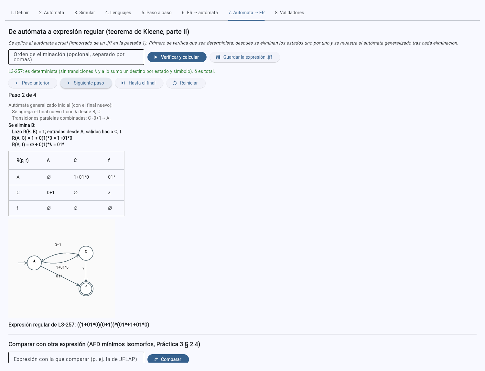
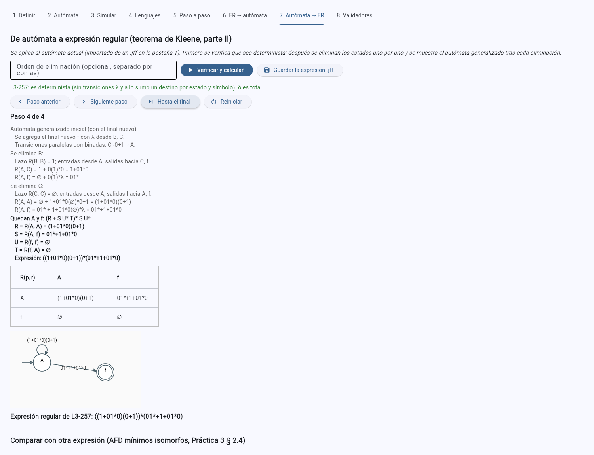
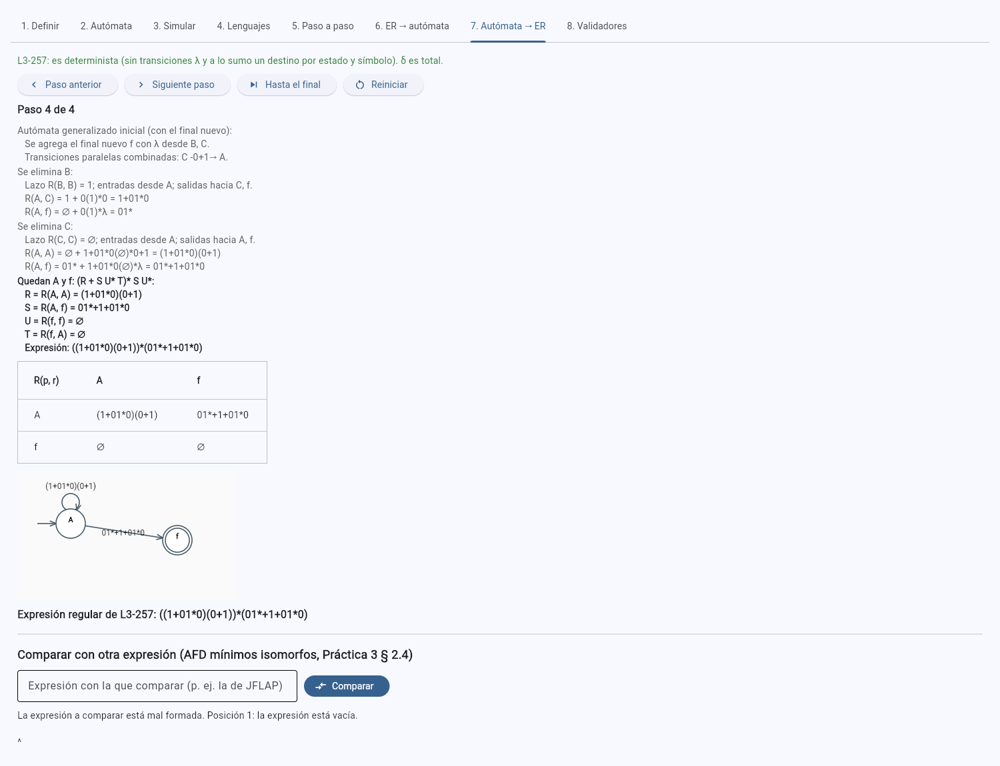

# Práctica 4 · Ejercicio 3. De autómata a expresión regular

[← Volver al índice](../../README.md)

Todo está en [`src/expresiones.py`](../../src/expresiones.py) (`problemas_de_determinismo`,
`eliminar_estados`, `comparar_expresiones`, `equivalente_al_automata`) y en la pestaña **7. Autómata → ER**
de [`src/app.py`](../../src/app.py), que se aplica al autómata actual, importado de un `.jff` en la pestaña 1.

## 3.1 Verificación de determinismo

Un autómata importado es un AFD si no tiene transiciones λ y δ(q, a) tiene a lo sumo un destino para cada
estado y símbolo. `problemas_de_determinismo` devuelve una lista con **cada estado y símbolo que lo impiden**:

```
El estado A tiene una transición λ hacia B.
δ(A, 1) = {B, C} tiene 2 destinos.
```

La pestaña 7 muestra la lista en rojo y no calcula nada hasta que se corrija (o se convierta con la pestaña
5, subconjuntos). Si δ es parcial (algún δ(q, a) = ∅), el autómata sigue siendo determinista: los pares que
faltan se tratan como transiciones al sumidero implícito, que en la expresión son ∅ y desaparecen; el
diagnóstico informa cuántos pares faltan.


## 3.2 Eliminación de estados, paso a paso

`eliminar_estados` sigue a Hopcroft et al. (2007, § 3.2.2) con las mismas convenciones que usa JFLAP en
*Convert FA to RE* (Práctica 3, Ejercicio 1), de modo que los resultados se puedan comparar carácter por
carácter:

1. **Un solo estado final, distinto del inicial.** Si hay varios finales, o el único final es el inicial, se
   agrega un final nuevo `f` unido con λ desde cada final (*Make Single Noninitial Final State*). Las
   transiciones paralelas entre dos estados se combinan en una unión (`C -0+1→ A`) y los pares sin transición
   llevan ∅. Es el **autómata generalizado inicial**: sus etiquetas son expresiones regulares.
2. **Se elimina cada estado q** que no es ni el inicial ni el final, en el orden de Q (o en el que escriba el
   usuario en *Orden de eliminación*). Para cada estado p con transición hacia q y cada r con transición desde
   q se hace
   R(p, r) := R(p, r) + R(p, q) R(q, q)* R(q, r),
   y después se borran q y sus transiciones. Cada actualización se registra con sus operandos y su resultado,
   y el autómata generalizado resultante se guarda como un paso: la pestaña 7 lo dibuja (con las expresiones
   como etiquetas) y lo muestra como tabla R(p, r).
3. **Fórmula de dos estados.** Quedan el inicial i y el final f: con R = R(i, i), S = R(i, f), U = R(f, f) y
   T = R(f, i), la expresión es (R + S U* T)* S U* (Hopcroft et al., 2007, § 3.2.2, figura 3.9). Si el inicial
   no tiene lazo ni entradas (R = T = ∅), la fórmula se reduce a S U*.

Las etiquetas se construyen con los constructores `union`, `concat` y `estrella` de `expresiones.py`, que
aplican las leyes algebraicas de la § 3.4 del libro, exactamente las que se usaron a mano en la Práctica 3:
∅ + r = r, ∅r = r∅ = ∅, λr = rλ = r, r + r = r, ∅* = λ, λ* = λ, (r*)* = r* y (λ + r)* = r*. Por eso un
camino que pasa por una transición ∅ no aporta nada, un estado sin lazo contribuye con (∅)* = λ, y la
expresión final no arrastra símbolos inútiles.

**Ejemplo: AFD 257 de la Lista 3** (A inicial; B y C finales), el mismo que se convirtió en JFLAP en la
Práctica 3:

| Paso | Autómata generalizado | Actualizaciones |
|---|---|---|
| 1 | Inicial: se agrega `f` con λ desde B y C; se combina `C -0+1→ A` | — |
| 2 | Se elimina B (lazo `1`; entra desde A; sale hacia C y f) | R(A, C) = 1 + 0(1)*0 = `1+01*0`; R(A, f) = ∅ + 0(1)*λ = `01*` |
| 3 | Se elimina C (sin lazo; entra desde A; sale hacia A y f) | R(A, A) = ∅ + (1+01*0)(∅)*(0+1) = `(1+01*0)(0+1)`; R(A, f) = 01* + (1+01*0)(∅)*λ = `01*+1+01*0` |
| 4 | Quedan A y f: R = `(1+01*0)(0+1)`, S = `01*+1+01*0`, U = ∅, T = ∅ | `((1+01*0)(0+1))*(01*+1+01*0)` |

| Paso 2: tras eliminar B | Paso 4: la fórmula final |
|---|---|
|  |  |

El resultado es, símbolo por símbolo, el de JFLAP en la Práctica 3 (paso 15 de
[`evidencias/practica3/jflap/L3-257`](../../evidencias/practica3/jflap/L3-257/)). Con otro orden de
eliminación (C antes que B) sale `(1(0+1)+01*0(0+1))*(1+01*(λ+0))`, distinta en su escritura pero
equivalente (`test_orden_de_eliminacion_distinto_da_una_expresion_equivalente`).

## 3.3 Comparación con JFLAP y prueba de equivalencia

Dos expresiones pueden escribirse de muchas formas, así que la comparación no es textual: *Comparar* convierte
las dos al AFD mínimo con el Ejercicio 2 (AFN-λ → sin λ → subconjuntos → mínimo) y aplica la prueba de
equivalencia de la Práctica 3 (§ 2.4): dos autómatas aceptan el mismo lenguaje si y solo si sus AFD mínimos
son isomorfos, por la unicidad del AFD mínimo (Hopcroft et al., 2007, § 4.4.4). La pestaña muestra el
veredicto, la biyección entre los estados y el tamaño de cada etapa.



**Casos de prueba.** Todos generados por `herramientas/practica4_generar.py`; los `.jff` de entrada, las
expresiones obtenidas (`*-ER.jff`) y el AFD mínimo de cada expresión (`*-ER-min.jff`) están en
[`automatas/practica4/casos-de-prueba/afd/`](../../automatas/practica4/casos-de-prueba/afd/). Las dos
columnas de expresiones se compararon con la prueba de equivalencia y además cada expresión obtenida se
comparó con el AFD original:

| AFD | Estados | Eliminados | Expresión obtenida | Expresión de referencia | ¿Equivalentes? | AFD mínimo |
|---|---|---|---|---|---|---|
| Lista 3, 254 | 2 | — | `(0+11*0)*11*` | `(0+1)*1` (Arden, Práctica 1) | sí | 2 |
| Lista 3, 255 | 2 | B | `((0+1)1*0)*` | `((0+1)1*0)*` (Arden, Práctica 1) | sí, idénticas | 2 |
| Lista 3, 256 | 2 | — | `(1+2+0(0+1)*2)*0(0+1)*` | la misma (Arden, Práctica 1) | sí, idénticas | 2 |
| Lista 3, 257 | 3 | B, C | `((1+01*0)(0+1))*(01*+1+01*0)` | `((1+01*0)(0+1))*(01*(λ+0)+1)` (Arden, Práctica 1) | sí | 3 |
| Lista 3, 258 | 3 | B | `((0+1)(01)*(1+00))*(0+1)(01)*` | `((0+1)(01)*(00+1))*(0+1)(01)*` (Arden, Práctica 1) | sí | 3 |
| Lista 4, 276 | 3 | B, C | `(b+ab*ab*a)*` | `(b+ab*ab*a)*` (Arden, Lista 4) | sí, idénticas | 3 |
| Lista 4, 277 | 2 | — | `(0+11*0)*11*` | `(0+11*0)*11*` (Arden, Lista 4); `0*1(0*1)*` (Rᵢⱼ⁽ᵏ⁾, Lista 4) | sí, idéntica a la de Arden | 2 |
| Práctica 3, L2-130 | 3 | q3 | `0*1(1+0(0+1))*` | la misma (JFLAP) | sí, idénticas | 3 |
| Práctica 3, L2-138 | 3 | q1, q2 | `(a+ba*ba*b)*` | la misma (JFLAP) | sí, idénticas | 3 |
| Práctica 3, L2-141 | 3 | q1, q2 | `(1+01)*` | la misma (JFLAP) | sí, idénticas | 3 |
| Práctica 3, L3-257 | 3 | B, C | `((1+01*0)(0+1))*(01*+1+01*0)` | la misma (JFLAP) | sí, idénticas | 3 |
| Práctica 3, L3-258 | 3 | B | `((0+1)(01)*(1+00))*(0+1)(01)*` | la misma (JFLAP) | sí, idénticas | 3 |

Observaciones:

* En los **cinco AFD de la Práctica 3** la expresión es idéntica a la de JFLAP, porque el software reproduce
  sus tres convenciones (final único, transiciones combinadas, orden alfabético de eliminación) y JFLAP
  aplica las mismas simplificaciones con ∅ y λ. En el 141, el sumidero q2 se elimina sin cambiar ninguna
  etiqueta (todos sus caminos de salida son ∅), y la comparación con el AFD completo da *equivalentes*, a
  diferencia de *Compare Equivalence* de JFLAP, que fallaba con ese sumidero (nota de la Práctica 3).
* En el **254 y el 277** (dos estados, el final distinto del inicial) no se elimina ningún estado: la fórmula
  de dos estados da directamente `(0+11*0)*11*`, la misma expresión que se obtuvo con el lema de Arden en la
  Lista 4; la expresión más corta `(0+1)*1` de la Práctica 1 es equivalente (ley (r*s)*r* = (r + s)*).
* En el **276** el inicial A es también final, así que se agrega `f` con `A -λ→ f`; al eliminar B y C queda el
  lazo `b + ab*ab*a` en A y S = λ, de donde `(b+ab*ab*a)*`, idéntica a la de Arden.
* Las expresiones de Arden del **257 y el 258** de la Práctica 1 difieren solo por una distributiva
  (`01*λ + 01*0 = 01*(λ+0)`) y una conmutatividad (`1+00 = 00+1`); los AFD mínimos tienen 3 estados y son
  isomorfos.

La **expresión obtenida se puede guardar** como `.jff` de expresión de JFLAP (`<type>re</type>`), con `!` por
λ como hace JFLAP, para abrirla allí y aplicarle *Convert to NFA*.

## 3.4 Pruebas

| Qué se comprueba | Pruebas |
|---|---|
| El diagnóstico lista cada δ(q, a) con varios destinos y cada transición λ; un AFD parcial pasa; el método rechaza un AFN con el mensaje | `test_verificacion_de_determinismo` |
| Los cinco AFD de la Práctica 3 dan exactamente la expresión de JFLAP, equivalente al AFD y a sí misma por AFD mínimos | `test_los_cinco_afd_de_la_practica3` |
| 254-258: equivalente al AFD y a la expresión de Arden de la Práctica 1 | `test_254_258_contra_arden_de_la_practica1` |
| 276 y 277: idéntica a la de Arden de la Lista 4 | `test_276_277_contra_arden_de_la_lista4` |
| Los pasos del 257: final nuevo, orden, estados vivos en cada paso, etiquetas intermedias y autómata generalizado | `test_pasos_de_la_eliminacion_257` |
| Otro orden da otra escritura pero el mismo lenguaje; un orden incompleto se rechaza; con `requerir_afd=False` el método también vale para AFN | `test_orden_de_eliminacion_distinto_da_una_expresion_equivalente`, `test_eliminacion_con_afn_si_se_permite` |
| La comparación detecta expresiones no equivalentes y reconoce las dos formas del 277 | `test_comparar_expresiones_no_equivalentes` |
