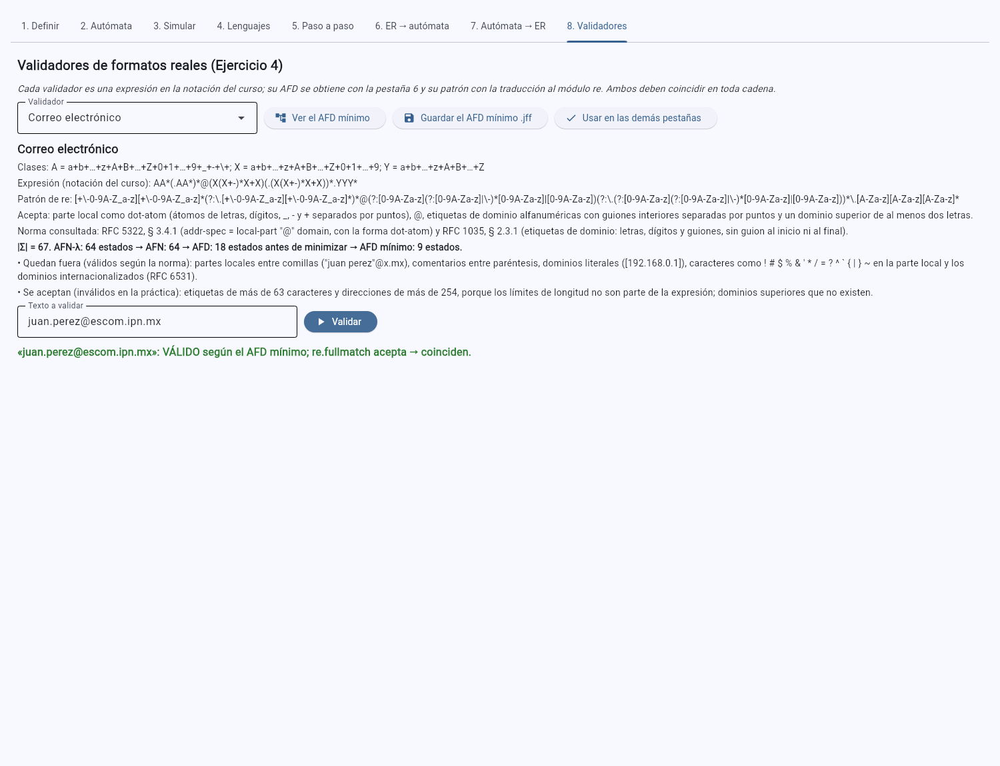
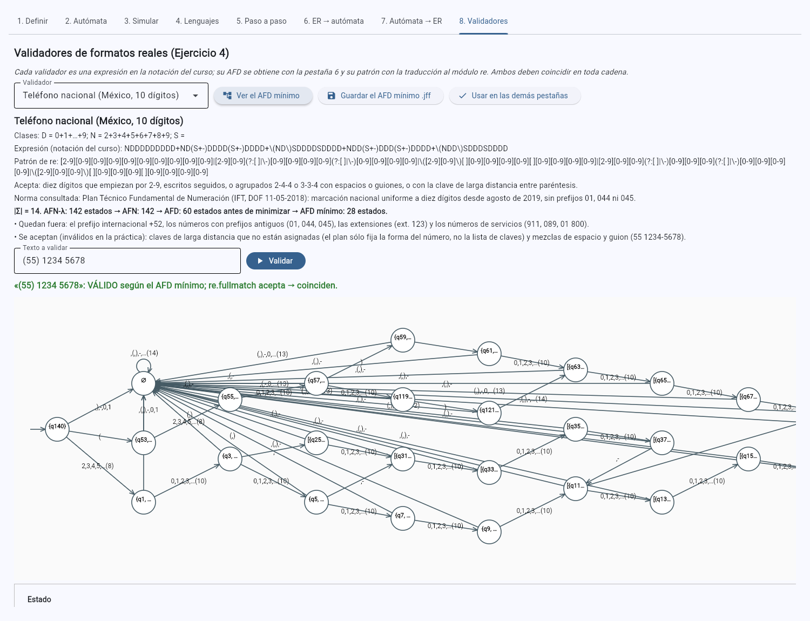
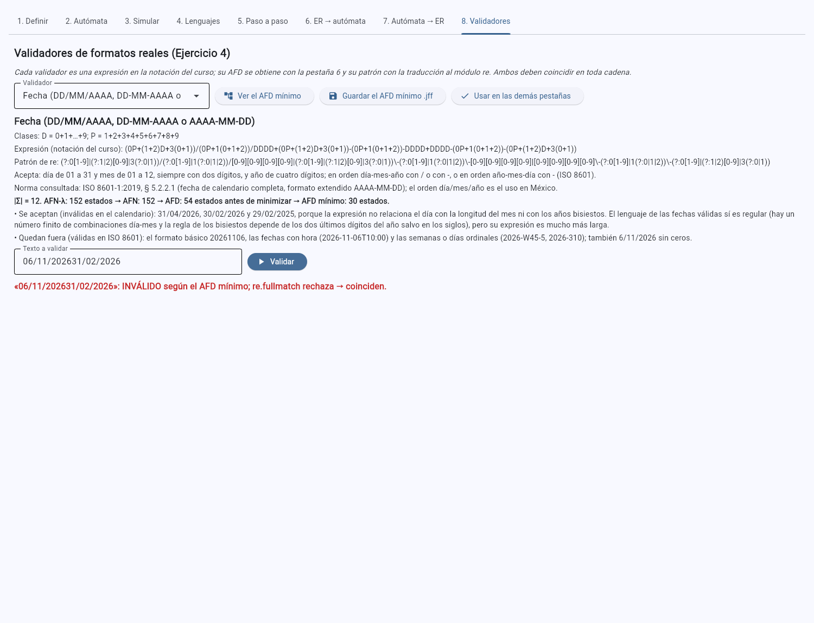
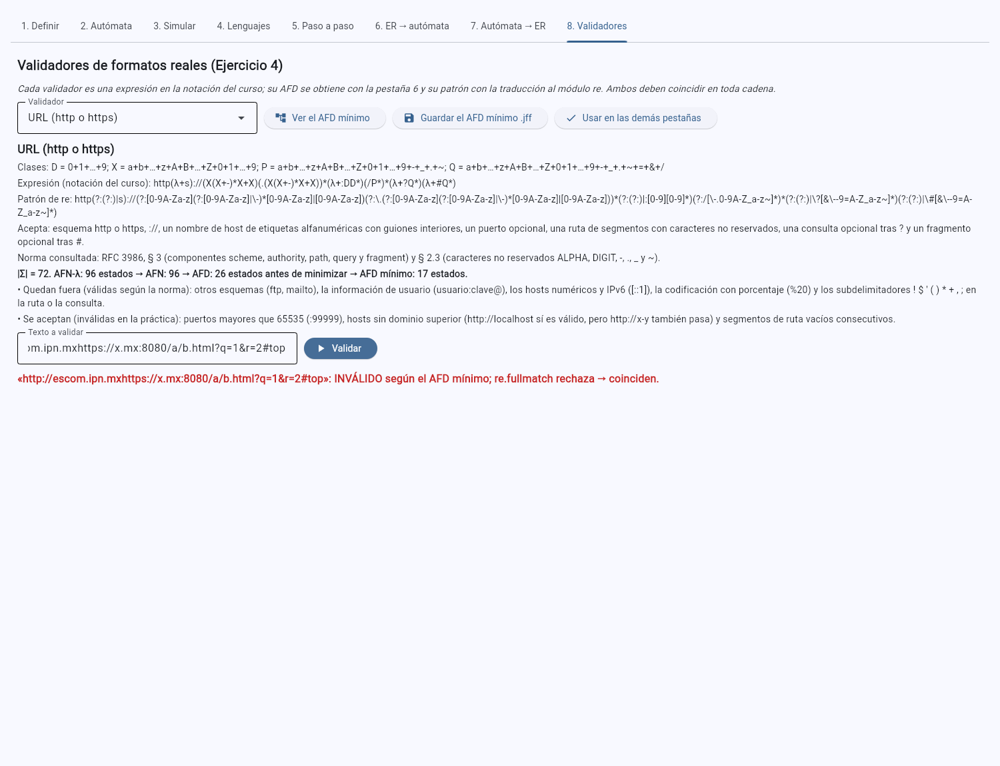

# Práctica 4 · Ejercicio 4. Aplicaciones: validadores

[← Volver al índice](../../README.md)

Se implementaron **cuatro** validadores: correo electrónico, teléfono nacional, fecha en tres formatos y URL.
Cada uno se define una sola vez, en la notación del curso con clases de símbolos declaradas
([`src/validadores.py`](../../src/validadores.py)); de esa definición salen el AFD (con el Ejercicio 2) y el
patrón del módulo `re` (con `a_python`). La pestaña **8. Validadores** muestra las dos escrituras, la norma
consultada, lo que queda fuera, el número de estados antes y después de minimizar, y valida el texto escrito
con el AFD mínimo y con `re.fullmatch` a la vez.

**Clases de símbolos declaradas** (abreviaturas que permite el enunciado):

| Clase | Símbolos |
|---|---|
| D | 0+1+…+9 |
| P | 1+2+…+9 (dígito distinto de cero) |
| N | 2+3+…+9 (primer dígito de un número nacional) |
| X | a+…+z+A+…+Z+0+…+9 (alfanuméricos) |
| Y | a+…+z+A+…+Z (letras) |
| A | X + _ + - + \+ (caracteres de un átomo de la parte local del correo) |
| S | ␣ (espacio) |
| P (URL) | X + - + _ + . + ~ (caracteres no reservados del RFC 3986) |
| Q (URL) | P + = + & + / (caracteres de consulta y fragmento) |

En la construcción del AFN-λ una clase es un caso básico con una transición por cada símbolo
(i -d→ f para cada d), lo que equivale a la unión de los casos básicos sin los estados que la eliminación de λ
quitaría; en `re` es una clase de caracteres `[…]` con rangos.

**Traducción a `re`.** `a_python` recorre el árbol: `+` → `|`, yuxtaposición → yuxtaposición, `*` → `*`,
λ → `(?:)`, ∅ → `(?!)`, clase → `[…]`, símbolo → `re.escape(símbolo)`; agrupa con `(?:…)` solo donde la
precedencia lo exige. Un patrón `a**` se escribe `(?:a*)*` porque `re` no admite dos cuantificadores
seguidos. La validación con `re` usa `fullmatch`, que exige que **toda** la cadena pertenezca al lenguaje,
igual que el autómata.

## 4.1 Correo electrónico

**Norma consultada:** RFC 5322, § 3.4.1 (`addr-spec = local-part "@" domain`, con `local-part` en la forma
`dot-atom`) y RFC 1035, § 2.3.1 (etiquetas de dominio: letras, dígitos y guiones, sin guion al inicio ni al
final; dominio superior alfabético).

```
AA*(.AA*)*@(X(X+-)*X+X)(.(X(X+-)*X+X))*.YYY*
```

Patrón de `re`:
`[+\-0-9A-Z_a-z][+\-0-9A-Z_a-z]*(?:\.[+\-0-9A-Z_a-z][+\-0-9A-Z_a-z]*)*@(?:[0-9A-Za-z](?:[0-9A-Za-z]|\-)*[0-9A-Za-z]|[0-9A-Za-z])(?:\.(?:[0-9A-Za-z](?:[0-9A-Za-z]|\-)*[0-9A-Za-z]|[0-9A-Za-z]))*\.[A-Za-z][A-Za-z][A-Za-z]*`

* `AA*(.AA*)*`: átomos no vacíos separados por un punto, sin puntos seguidos ni en los extremos.
* `(X(X+-)*X+X)`: una etiqueta de dominio es un alfanumérico, o empieza y termina con alfanumérico y lleva
  alfanuméricos o guiones en medio.
* `.YYY*`: el dominio superior tiene al menos dos letras.

|Σ| = 67; AFN-λ de **64** estados → AFD de **18** estados → AFD mínimo de **9** estados.

**Queda fuera (válido según la norma):** la parte local entre comillas (`"juan perez"@x.mx`), los comentarios
entre paréntesis, los dominios literales (`juan@[192.168.0.1]`), los caracteres `! # $ % & ' * / = ? ^ \` { | }
~` que el RFC 5322 permite en un átomo, y los correos internacionalizados con letras acentuadas (RFC 6531).
**Se acepta (inválido en la práctica):** etiquetas de más de 63 caracteres y direcciones de más de 254,
porque las longitudes no están en la expresión, y dominios superiores que no existen (`a@b.zz`).



## 4.2 Teléfono nacional (México, diez dígitos)

**Norma consultada:** Plan Técnico Fundamental de Numeración del Instituto Federal de Telecomunicaciones
(acuerdo publicado en el DOF el 11 de mayo de 2018): desde el 3 de agosto de 2019 toda llamada nacional se
marca con diez dígitos, sin los prefijos 01, 044 y 045; los números nacionales no empiezan con 0 ni con 1.

```
NDDDDDDDDD + ND(S+-)DDDD(S+-)DDDD + \(ND\)SDDDDSDDDD + NDD(S+-)DDD(S+-)DDDD + \(NDD\)SDDDSDDDD
```

Los paréntesis de la clave de larga distancia se escriben `\(` y `\)` porque en la notación del curso los
paréntesis agrupan. Cinco formas: los diez dígitos seguidos; agrupados 2-4-4 o 3-3-4 con espacio o guion
(claves de dos dígitos como 55 y 33, o de tres como 331 y 449); y la clave entre paréntesis seguida de
espacios.

|Σ| = 14; AFN-λ de **142** estados → AFD de **60** estados → AFD mínimo de **28** estados. La minimización
funde, por ejemplo, los estados «faltan k dígitos» que las cinco ramas tienen en común al final.

**Queda fuera (válido en otros contextos):** el prefijo internacional `+52 55 …`, los prefijos antiguos
`01`, `044` y `045`, las extensiones (`ext. 123`) y los números de servicios (`911`, `089`, `800 …`).
**Se acepta (inválido en la práctica):** claves de larga distancia no asignadas (el plan fija la forma, no la
lista de claves), y mezclas de separadores (`55 1234-5678`), porque cada separador se elige
independientemente.



## 4.3 Fecha en tres formatos

**Norma consultada:** ISO 8601-1:2019, § 5.2.2.1 (fecha de calendario completa en formato extendido,
`AAAA-MM-DD`); el orden día/mes/año con `/` o `-` es el de uso común en México.

```
(0P+(1+2)D+3(0+1))/(0P+1(0+1+2))/DDDD + (0P+(1+2)D+3(0+1))-(0P+1(0+1+2))-DDDD + DDDD-(0P+1(0+1+2))-(0P+(1+2)D+3(0+1))
```

* Día `(0P + (1+2)D + 3(0+1))`: 01-09, 10-29 o 30-31, siempre con dos dígitos.
* Mes `(0P + 1(0+1+2))`: 01-09 o 10-12.
* Año `DDDD`: cuatro dígitos (0000-9999, como permite ISO 8601 en el formato extendido).

|Σ| = 12; AFN-λ de **152** estados → AFD de **54** estados → AFD mínimo de **30** estados.

**Se acepta (inválido en el calendario):** `31/04/2026`, `30/02/2026` y `29/02/2025`, porque la expresión no
relaciona el día con el mes ni con los años bisiestos. Ese lenguaje **sí es regular** (hay un número finito de
pares día-mes y la regla de los bisiestos depende de los dos últimos dígitos del año, con la excepción de los
siglos), pero su expresión es mucho más larga; se dejó fuera a propósito y la pestaña lo muestra: `31/02/2026`
se acepta. **Queda fuera (válido en ISO 8601):** el formato básico `20261106`, las fechas con hora
(`2026-11-06T10:00`), las semanas y días ordinales (`2026-W45-5`, `2026-310`) y las fechas sin ceros a la
izquierda (`6/11/2026`).



## 4.4 URL (http y https)

**Norma consultada:** RFC 3986, § 3 (componentes `scheme`, `authority`, `path`, `query` y `fragment`) y
§ 2.3 (caracteres no reservados: letras, dígitos, `-`, `.`, `_` y `~`).

```
http(λ+s)://(X(X+-)*X+X)(.(X(X+-)*X+X))*(λ+:DD*)(/P*)*(λ+?Q*)(λ+#Q*)
```

* `http(λ+s)://`: esquema http o https (los dos puntos, las barras, `?` y `#` son símbolos del alfabeto, no
  operadores).
* El host son etiquetas como en el correo; `(λ+:DD*)` es un puerto opcional; `(/P*)*` es una ruta de cero o
  más segmentos (posiblemente vacíos, como permite el RFC); `(λ+?Q*)` y `(λ+#Q*)` son la consulta y el
  fragmento opcionales.

|Σ| = 76; AFN-λ de **96** estados → AFD de **26** estados → AFD mínimo de **17** estados.

**Queda fuera (válido según la norma):** otros esquemas (`ftp`, `mailto`), la información de usuario
(`usuario:clave@`), los hosts numéricos y IPv6 (`[::1]`), la codificación con porcentaje (`%20`) y los
subdelimitadores `! $ ' ( ) * + , ;` en la ruta o la consulta. **Se acepta (inválido en la práctica):** puertos
mayores que 65535 y hosts que no existen; `http://localhost:8550` (el simulador en Docker) es válido.



## 4.5 Por qué no contraseña

El quinto validador del enunciado (contraseña con criterios como «al menos una letra, un dígito y entre 8 y 16
caracteres») es un lenguaje regular —intersección de lenguajes regulares— pero su expresión sin
anticipaciones (`(?=…)`) es la unión de todos los órdenes posibles de «primero aparece una letra» y «primero
aparece un dígito», mucho más larga que informativa, y en `re` se escribiría con anticipaciones, que la
notación del curso no tiene. Se prefirieron cuatro validadores cuya expresión del curso y cuyo patrón de `re`
son la misma fórmula.

## 4.6 Congruencia entre modelos: las pruebas

`tests/test_practica4.py::test_validador_congruente_con_re` compara, para cada validador, el AFD mínimo con
`re.fullmatch` sobre **600 cadenas** (300 válidas y 300 inválidas; el enunciado pide al menos 500), generadas
por `validadores.ejemplos(clave)` con este procedimiento, reproducible con una semilla fija:

1. **Cadenas válidas (300).** Los ejemplos fijos de cada validador más cadenas construidas pieza por pieza
   según la definición del formato con un generador pseudoaleatorio (`random.Random("2026-<clave>")`): para el
   correo, de uno a tres átomos de uno a seis caracteres, de una a tres etiquetas de dominio y un dominio
   superior de dos a cuatro letras; para el teléfono, un primer dígito de 2-9, nueve dígitos y una de las cinco
   formas; para la fecha, día 1-31, mes 1-12, año 0-9999 y uno de los tres formatos; para la URL, esquema,
   de una a tres etiquetas, puerto con probabilidad 0.3, de cero a tres segmentos, consulta con probabilidad
   0.4 y fragmento con 0.3. Cada etiqueta de dominio se genera para cumplir la regla del guion.
2. **Cadenas inválidas (300).** Los ejemplos fijos más, con probabilidad 0.8, una **mutación** de una cadena
   válida (borrar, insertar, cambiar o duplicar un carácter, recortar, pegar un carácter al final; con
   probabilidad 0.3 se aplican dos mutaciones), y con probabilidad 0.2, **ruido**: de 0 a 25 caracteres al azar
   del alfabeto del validador y de un conjunto de caracteres ajenos (` . @ / : - _ ( ) + # ? = & ~ % ! , ; ' "
   [ ] { } á é í ñ` y tabulador). Solo se conservan las que `re.fullmatch` rechaza y no estaban ya.
3. La prueba afirma que las 300 válidas son aceptadas por `re`, que las 300 inválidas son rechazadas por `re`,
   y que **el autómata da el mismo veredicto que `re.fullmatch` en las 600**. `test_validador_ejemplos_fijos`
   comprueba además los ejemplos fijos con el autómata y los tamaños de las etapas, y
   `test_validadores_exportados_al_repositorio` que los AFD mínimos guardados en
   [`automatas/practica4/validadores/`](../../automatas/practica4/validadores/) son isomorfos a los que
   produce el software.

Las cadenas con caracteres fuera de Σ se rechazan en los dos modelos: el autómata no tiene transición y el
patrón no tiene ese carácter. Las pruebas corren en la integración continua con Python 3.11, 3.12 y 3.13
(evidencia en [`evidencias/practica4/ci/`](../../evidencias/practica4/ci/)).

| Validador | Σ | AFN-λ | AFN | AFD | AFD mínimo | Archivos |
|---|---|---|---|---|---|---|
| Correo | 67 | 64 | 64 | 18 | 9 | `correo-ER.jff`, `correo-afn-lambda.jff`, `correo-min.jff`, `correo-re.txt` |
| Teléfono | 14 | 142 | 142 | 60 | 28 | `telefono-*` |
| Fecha | 12 | 152 | 152 | 54 | 30 | `fecha-*` |
| URL | 76 | 96 | 96 | 26 | 17 | `url-*` |
